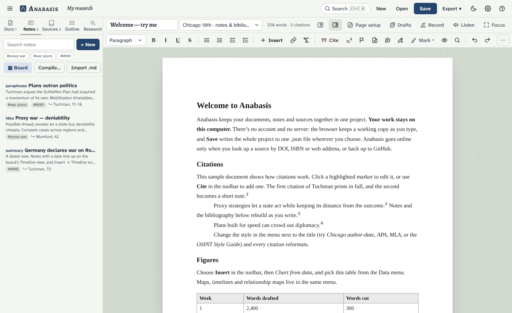
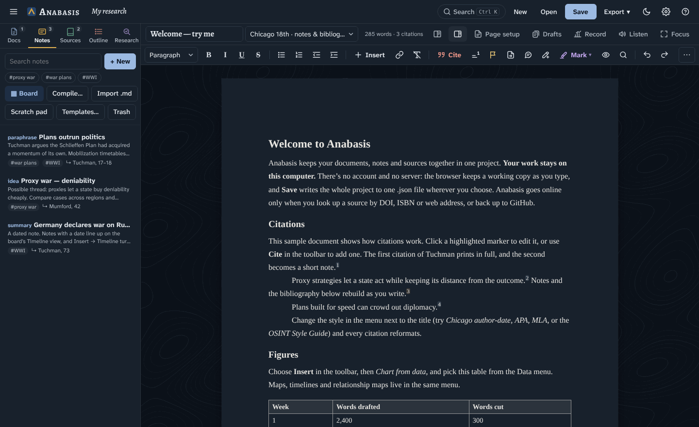
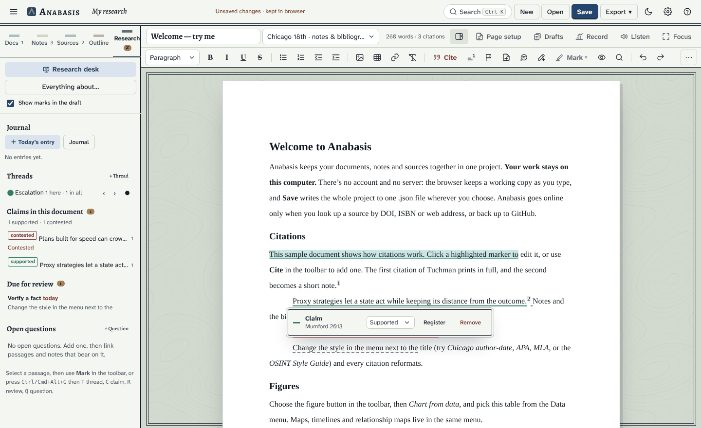

<p align="center"></p>

<h1 align="center">Anabasis</h1>

<p align="center">A writing desk for nonfiction. Documents, notes, sources and citations in one offline HTML file.</p>

<p align="center">
  <em>θάλαττα θάλαττα</em><br>
  Presently they could hear the soldiers shouting and passing on the joyful word, “The sea! the sea!”<br>
  <sub>Xenophon, <em>Anabasis</em> IV.7, translated by H. G. Dakyns</sub>
</p>

<p align="center">
  <a href="https://github.com/gmichaelrapp/anabasis/releases/latest"><b>Download</b></a> ·
  <a href="https://gmichaelrapp.github.io/anabasis/"><b>Try it in your browser</b></a> ·
  <a href="docs/quick-start.md"><b>Quick start</b></a> ·
  <a href="docs/privacy.md">Privacy</a> ·
  <a href="CHANGELOG.md">What’s new</a>
</p>



Anabasis is for people who write from sources: historians, analysts, journalists, students and anyone working on a book, a white paper, a long article or a newsletter. It keeps your drafts, research notes and bibliography in one project. It formats citations as you write, and it checks the draft the way a careful editor would.

The whole app is a single HTML file of about 10 MB. Download it, open it in your browser, and it works offline. There’s no account, no server and no tracking.

## What it does

**Write and cite**
- A word processor with headings, lists, tables, footnotes and figures, plus margin notes, focus mode and freewriting sprints.
- Citations in 55 styles: Chicago (notes or author-date), APA, MLA, MHRA, Harvard, APSA, ASA, OSCOLA, Bluebook, AMA, Vancouver, CSE, IEEE, Nature and more, plus the [OSINT Style Guide](https://gmichaelrapp.github.io/OSINT_Cites/). Switch styles at any time and every citation reformats. *Ibid.*, short forms and the bibliography are handled for you.
- Add sources by DOI, ISBN or web address, or import BibTeX, RIS and Zotero's CSL-JSON. Export them the same three ways, so nothing is locked in. Each source can carry an Admiralty reliability rating.
- **Suggest mode** marks your edits for review, like tracked changes, and Word files carry them both ways: tracked changes and comments in, tracked changes and comments out.
- **Pandoc / Quarto and LaTeX packages**: the text with citation keys, its .bib file and the style, ready for `pandoc --citeproc`, Overleaf or `latexmk`.
- **Listen** reads the draft aloud, sentence by sentence, with the browser's own voices.
- A binder of chapters and parts that compiles into a manuscript, with an index, front and back matter, and a chronology built from dated notes.

**Research**
- Five example projects to learn from or build on: a thesis chapter, a long-form article, a white paper, a book proposal and an investigative piece.
- Notes and quotes on a board you can pile, pin, tag and drag into a draft. A PDF reader sits beside the draft, and a web clipper captures from other tabs.
- Interview transcripts from caption files (.srt, .vtt), text or Word, turned into quote notes with timestamps.
- Imports Markdown notes from Obsidian and similar tools, and Word documents (footnotes included).
- Threads, claims, review keys and questions marked right in the draft. Follow a thread through every chapter, keep a claims register with a printable fact-check sheet, see claims against sources in an evidence grid, set passages to come back to by a date, and gather everything about one name or term (with its other spellings) in one place.
- A research journal: the research design (questions, methods, data, scope, ethics), hypotheses tracked against the evidence for and against them with a dated status history, a daily log of what you did, found and decided, and a search log. It turns into a research memo or a methods appendix in one click.

**Figures**
- Charts from a table: columns, bars, lines, areas, dot plots and small multiples, with event lines and shaded periods.
- Maps that work offline: shade countries or provinces, and add markers, routes, arrows and hatched areas, with rivers, a scale bar and a locator inset.
- Timelines from dated notes, and relationship maps of the people, places and organizations in your text.

**Check the draft**
- Undefined or late-defined acronyms, vague estimative language (against the ICD 203 scale), and paragraphs resting on a single source or only on weak ones.
- House style: numbers, dates, the serial comma, US or U.S., dashes, quotes and your preferred spellings. Accessibility: alt text, heading order, table headers and link text.
- Find and replace across every document. Drafts you can compare side by side, and checkpoints of the whole project.

**Publish**
- PDF with real footnotes, Word (.docx), ePub, HTML, Markdown and a Substack-ready post, plus a promo kit with a social thread, subtitle and quote cards.
- Video-script mode with run time, an A/V table and a teleprompter.
- Optional password lock (AES-256-GCM) and optional backup to a private GitHub repository.

| | |
|---|---|
|  |  |
|  |  |
|  |  |
|  | |

## Getting started

**New to Anabasis? Follow the [quick start](docs/quick-start.md):** blank page to finished PDF in twelve illustrated steps.

1. Download `anabasis.html` from the [latest release](https://github.com/gmichaelrapp/anabasis/releases/latest).
2. Open it in your browser. A short tour and a sample project show you around.
3. Choose **Save** to keep your project as a `.json` file. Keep that file somewhere backed up, such as a synced folder.

You can also use the [hosted copy](https://gmichaelrapp.github.io/anabasis/). It is the same file and still keeps everything in your browser.

### On an iPhone or iPad

Open the [hosted copy](https://gmichaelrapp.github.io/anabasis/) in Safari, tap **Share**, then **Add to Home Screen**. Anabasis then opens like an app, full screen, and works offline once it has loaded. Android browsers offer **Install app** in their menu.

The installed app keeps its own working copy, separate from Safari's, so save your project file and open it there to carry work across. Saving on a phone or tablet puts the `.json` file in Files (or Downloads) each time.

### Browsers

Anabasis works best in current desktop **Chrome**, **Edge**, **Brave** or another Chromium browser. In those browsers it can save straight back to your project file and autosave to it.

**Firefox** and **Safari** work too. Saving downloads a fresh copy of the project file each time instead of overwriting it, and some highlights in the checks appear only in the lists, not in the text.

On phones and tablets the layout adapts: the sidebar becomes a drawer, toolbar buttons that don't fit move into a **⋯** menu, and dialogs open full screen. A computer is still the most comfortable place for a long working session.

## Your data

Your project lives in two places: the `.json` file you save, and a working copy in your browser so nothing is lost if the tab closes. Anabasis connects to the internet only when you ask it to look up a source or back up to GitHub. [More about privacy](docs/privacy.md).

The project file is plain JSON, documented in [docs/file-format.md](docs/file-format.md), so your work is never locked in.

## Building from source

You need Python 3.10 or later. Nothing else is needed for the build, and it never touches the network.

```sh
python build.py --check     # verifies vendored files, writes dist/anabasis.html
```

To run the tests (Playwright and Chromium):

```sh
pip install playwright && python -m playwright install chromium
python tests/run_tests.py
```

Other tools:

```sh
python tools/site/build_site.py        # the installable hosted copy (site/), as published to GitHub Pages
python tools/guide/quickstart.py       # the quick-start screenshots
python tools/guide/screenshots.py      # the interface screenshots in this README
```

See [CONTRIBUTING.md](CONTRIBUTING.md) for how the code is laid out.

## License

Anabasis is free software under the [GNU Affero General Public License v3.0 or later](LICENSE). You can use, study, share and change it. If you distribute a modified version, or run one for others over a network, you must share its source under the same license.

Anabasis is built on excellent open-source work, including citeproc-js, the Citation Style Language styles, PDF.js, Paged.js, docx, mammoth, Chart.js, d3, DOMPurify and Natural Earth. See [THIRD-PARTY-NOTICES.md](THIRD-PARTY-NOTICES.md).

Copyright © 2026 G. Michael Rapp.
