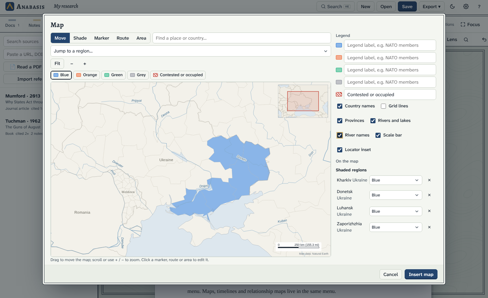
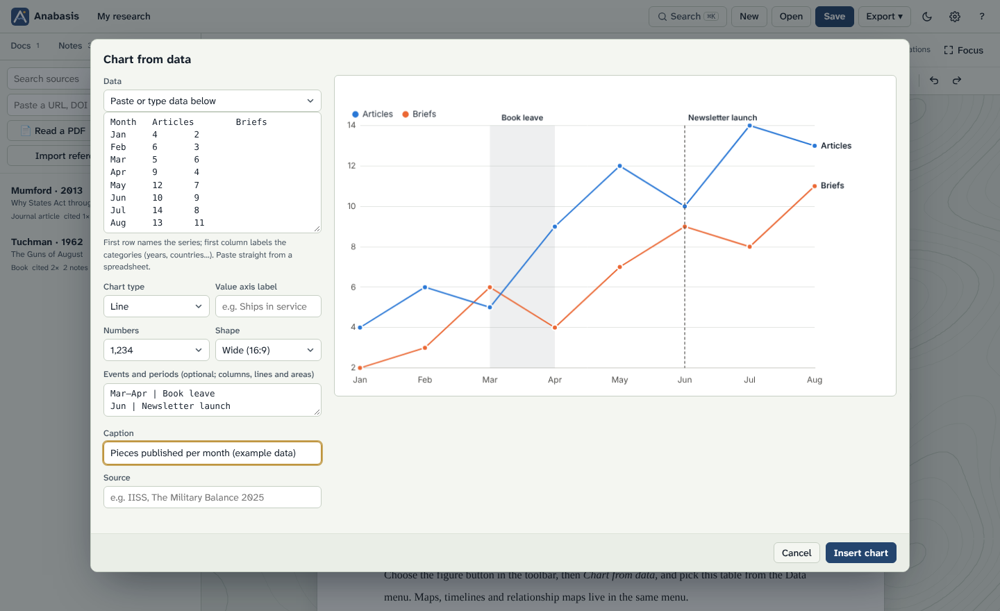
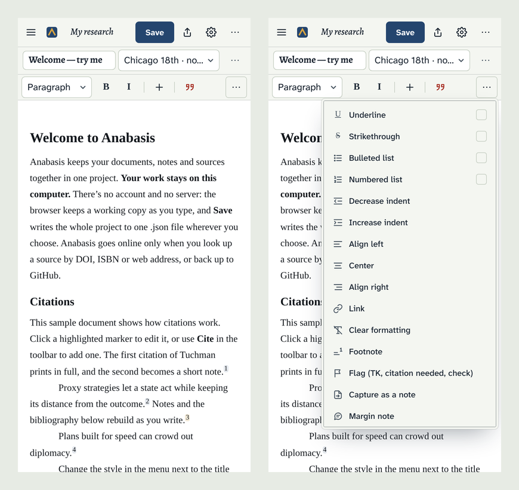
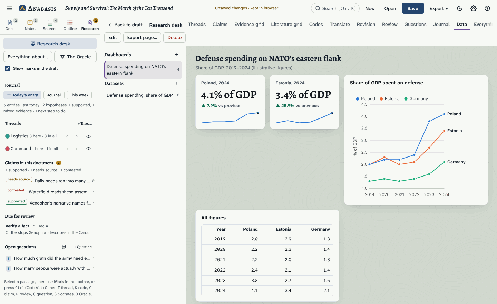
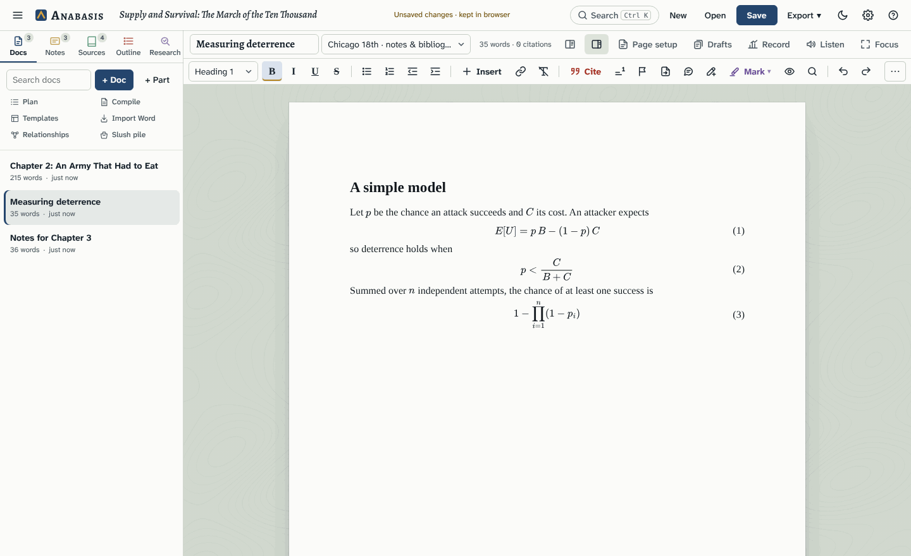

<p align="center"></p>

<h1 align="center">Anabasis</h1>

<p align="center">A writing desk for nonfiction. Documents, notes, sources and citations in one offline HTML file.</p>

<p align="center">
  <em>θάλαττα θάλαττα</em><br>
  Presently they could hear the soldiers shouting and passing on the joyful word, “The sea! the sea!”<br>
  <sub>Xenophon, <em>Anabasis</em> IV.7, translated by H. G. Dakyns</sub>
</p>

<p align="center">
  <a href="https://github.com/gmichaelrapp/anabasis/releases/latest"><b>Download</b></a> ·
  <a href="https://zerohistory.net/anabasis/app/"><b>Try it in your browser</b></a> ·
  <a href="https://zerohistory.net/anabasis/">Website</a> ·
  <a href="docs/quick-start.md"><b>Quick start</b></a> ·
  <a href="docs/privacy.md">Privacy</a> ·
  <a href="CHANGELOG.md">What’s new</a>
</p>


Anabasis is for people who write from sources: historians, analysts, journalists, students and anyone working on a book, a white paper, a long article or a newsletter. It keeps your drafts, research notes and bibliography in one project. It formats citations as you write, and it checks the draft the way a careful editor would.

The whole app is a single HTML file of about 23 MB. Download it, open it in your browser, and it works offline. There’s no account, no server and no tracking.

## What it does

**Write and cite**
- A word processor with headings, lists, tables, footnotes and figures, plus margin notes, focus mode and freewriting sprints.
- Citations in 55 styles: Chicago (notes or author-date), APA, MLA, MHRA, Harvard, APSA, ASA, OSCOLA, Bluebook, AMA, Vancouver, CSE, IEEE, Nature and more, plus the [OSINT Style Guide](https://gmichaelrapp.github.io/OSINT_Cites/). Switch styles at any time and every citation reformats. *Ibid.*, short forms and the bibliography are handled for you.
- Add sources by DOI, ISBN or web address, or import BibTeX, RIS and Zotero’s CSL-JSON. Export them the same three ways, so nothing is locked in. Each source can carry an Admiralty reliability rating, and its type: primary, secondary or tertiary.
- **Write in 27 languages**: spell-checking, quotation marks, citation terms, word counts and Listen follow the document’s language; Arabic, Hebrew, Persian and Urdu run right to left; and a quotation can be marked in a language of its own.
- Equations written in TeX, in a sentence or on their own line and numbered, drawn offline by MathJax. They go into Word as real, editable Word equations and come back as TeX.
- Cross-references to figures, tables, equations, headings and chapters that renumber themselves and become links in Word, PDF and e-books.
- A binder of chapters and parts that compiles into a manuscript, with an index, front and back matter, and a chronology built from dated notes.
- **Suggest mode** marks your edits for review, like tracked changes, and Word files carry tracked changes and comments both ways.
- **Co-writing without a server**: send a co-author or editor a copy, then take their changes back as suggestions to accept or reject.
- **Reviews from anyone**: send a reviewer one web page they can comment on in any browser, then import their comments into your margin and their changes as suggestions, placed correctly even after you’ve kept writing.
- **Listen** reads the draft aloud, sentence by sentence, with the browser’s own voices.
- Special characters for scientific and academic writing (math, logic, units, scholarly marks) found by name, and **copy citation** in any style.

**Read and take notes**
- **A reader for PDFs and DRM-free ePubs** beside the draft: quote and paraphrase notes with their pages filled in, highlights in four colors with no note needed, quotes straight into the draft with their citation, reading aloud, contents and page thumbnails, every Find match in a list, paper, sepia and night, and two pages side by side. Each PDF or book reopens where you left off. An ePub quote gets the printed page when the book marks its pages, or its chapter and paragraph.
- **Take notes** fills the screen with the reader and a note pad side by side.
- Notes and quotes on a board you can pile, pin, tag and drag into a draft; note templates for interviews, archive visits, source summaries, field notes and meetings; a scratch pad for jotting now and sorting later; and a note trash that keeps deleted notes 30 days.
- A web clipper, interview transcripts from caption files (.srt, .vtt), text or Word, and Markdown notes from Obsidian and similar tools.
- **Archive photos**: file pictures from an archive visit by box and folder, transcribe them beside the image (or have a typed page read for you, offline), and make quote notes that cite the box and folder.
- **Search inside sources**: the full text of your PDFs, ePubs, photo transcriptions and interview transcripts, opened at the page. Scanned PDFs are read on your computer (Tesseract), never uploaded.
- **A reading list** with how far you’ve got in each source, **My library** (a shelf of sources and notes in your browser, for any project), a retraction check through Crossref, duplicate sources found and merged, and SHA-256 fingerprints for evidence files.
- **A rhetorical précis** of a source in four sentences, and **following a Zotero library** through a Better BibTeX auto-export file, so changes come in by themselves.

**Research and think it through**
- **A research journal**: the research design (questions, methods, data, scope, ethics), hypotheses tracked against the evidence for and against them, a daily log of what you did, found and decided, a search log, and twelve prompts for the stages of a project, from a first topic to peer feedback. It turns into a research memo or a methods appendix in one click.
- **A research guide**: what each stage of a project is for and how to tell when it’s done, due-diligence checklists, short guides to eight research methods, and a glossary.
- Threads, claims, review keys and questions marked right in the draft: follow a thread through every chapter, keep a claims register with a printable fact-check sheet, see claims against sources in an evidence grid, and gather everything about one name or term in one place.
- **A literature grid** that sets your sources against your questions and themes and drafts a literature review from it, and **qualitative coding** with a codebook, counts by source and the codes that turn up together.
- **Socrates** offers questions to start from: 475 in 24 kinds, filled in with whatever you’ve selected. He reads a chapter for the places that need a question (sweeping words, claims of cause, unnamed authorities, facts without a source) and walks you through examining a claim, a steelman, a pre-mortem, competing explanations and defining your terms.
- **The Oracle**, a conversation partner in the manner of ELIZA, the 1960s MIT chatbot. It turns what you say into questions, answers from your own notes and sources, files notes and journal entries as you talk, argues the other side, starts the day where you left off and says what to work on next. Gentle, plain or blunt: you choose.
- Socrates and the Oracle use no AI and nothing online; everything stays on your computer.
- **Translation**: notes that keep the original beside your translation, a glossary checked as you write, standard transliteration for Russian, Ukrainian, Bulgarian, Serbian, Greek and Arabic, and a workspace for translating segment by segment.
- Pseudonyms used in every export while the project keeps the real names, with each person’s consent recorded and checked.

**Figures and data**
- Charts from a table: columns, bars, lines, areas, small multiples, dot plots, scatter and bubble, histograms and heatmaps, with event lines and shaded periods.
- Maps that work offline: shade countries, US states or provinces, and add markers, routes, arrows and hatched areas, with rivers, a scale bar and a locator inset.
- Timelines from dated notes, and relationship maps of the people, places and organizations in your text.
- **Data dashboards**: bring in a CSV, lay out headline numbers, charts, maps, timelines and searchable tables, each crediting its source, and export the whole thing as one web page. Numbers and charts placed in your writing update when the data changes.
- Credit lines and permission status for every figure and table, with a permissions log for your editor.

**Plan, revise and finish**
- **Project home** with a calendar of the words you wrote each day, deadlines, journal entries, archive visits and interviews, exported as an .ics file. **Submissions** tracks where each piece has gone, its status and fee.
- **The revision pass**: the revision lens shades clichés, same-length runs, pet words, *-ly* adverbs and buried verbs, and the Research desk’s **Revision** view sets every chapter side by side with a dated checklist for each.
- **Editing marks**, the copyeditor’s set (query to author, verify, stet, transpose, close up and the rest), signed and dated, to accept or reject. Reviewers can mark the page you send them too.
- **A slush pile** for the passages you cut and the documents you delete, searchable and ready to put back.
- Contents and lists of figures, tables and equations that fill themselves in; paragraph and line numbers in the page and in exports.
- Drafts you can compare side by side, checkpoints of the whole project, and find and replace across every document.

**Check the draft**
- **Proofread** (F7): about 400 common misspellings, mixed-up words (“would of”, “more then”, “your welcome”), *a* and *an* by sound, doubled words, spacing and capitals, with fix, fix all and ignore. Offline, and no grammar engine.
- **Close to your notes**: sentences that repeat a note’s wording without quotation marks, fixed in one click.
- Undefined or late-defined acronyms, vague estimative language (against the ICD 203 scale), and paragraphs resting on a single source or only on weak ones.
- House style (numbers, dates, the serial comma, US or U.S., dashes, quotes and your preferred spellings) and accessibility (alt text, heading order, table headers and link text).
- **A link check** against the Wayback Machine that keeps archived copies of your web sources.

**Publish**
- PDF with real footnotes, Word (.docx), ePub, HTML, Markdown and a Substack-ready post, plus a promo kit with a social thread, subtitle and quote cards.
- **Book for print**: a print-ready PDF at a trim size, with mirrored margins, chapters on right-hand pages, running heads, and the front matter made for you.
- A PDF for reviewers with numbered lines, Word in standard manuscript format, and **submission packages**: the piece (anonymized for blind review if you like), a title page and your cover letter, pitch, query, synopsis or proposal, in one .zip.
- **An abstract and keywords**, built a part at a time with sentences suggested from the draft, under the title in every export.
- **Pandoc / Quarto and LaTeX packages**: the text with citation keys, its .bib file and the style, ready for `pandoc --citeproc`, Overleaf or `latexmk`.
- Video-script mode with run time, an A/V table and a teleprompter.
- **Archive**: the whole project as plain files (Markdown, BibTeX, CSL-JSON, images, the project file and a README), readable without Anabasis for as long as there are computers.

**Around the app**
- Five example projects to learn from: a thesis chapter, a long-form article, a white paper, a book proposal and an investigative piece, and getting-started tips for ten kinds of writing.
- Notes, sources, the research desk or another document beside the writing, or in a window of their own on a second screen.
- **Install it as an app** from the hosted copy (Settings → This browser → Install Anabasis, in Chrome or Edge, or Add to Dock in Safari): its own window and icon, and it works offline.
- Text size, typeface and line spacing for the screen, separate from what you export; what’s new after each update; **⌘/Ctrl E** for what you opened last; and Send feedback in Help.
- Optional password lock (AES-256-GCM) and optional backup to a private GitHub repository, which also lets you pick up a project on another device.

| | |
|---|---|
|  |  |
|  |  |
|  |  |
|  |  |
|  |  |

## Getting started

**New to Anabasis? Follow the [quick start](docs/quick-start.md):** blank page to finished PDF in twelve illustrated steps.

For more depth on any feature, see the **[wiki](https://github.com/gmichaelrapp/anabasis/wiki)**: citations and sources, notes and the board, the reader, the research journal, Socrates and the Oracle, the checks, and every export.

1. Download `anabasis.html` from the [latest release](https://github.com/gmichaelrapp/anabasis/releases/latest).
2. Open it in your browser. A short tour and a sample project show you around.
3. Choose **Save** to keep your project as a `.json` file. Keep that file somewhere backed up, such as a synced folder.

You can also use the [hosted copy](https://zerohistory.net/anabasis/app/). It is the same file and still keeps everything in your browser.

Anabasis is published by [Zero History](https://zerohistory.net/). The old address, gmichaelrapp.github.io/anabasis, keeps working. A browser keeps a separate working copy for each address, so if you move to the new one, save your project from the old address and open the file at the new one.

### On an iPhone or iPad

Open the [hosted copy](https://zerohistory.net/anabasis/app/) in Safari, tap **Share**, then **Add to Home Screen**. Anabasis then opens like an app, full screen, and works offline once it has loaded. Android browsers offer **Install app** in their menu.

The installed app keeps its own working copy, separate from Safari’s, so save your project file and open it there to carry work across. Saving on a phone or tablet puts the `.json` file in Files (or Downloads) each time.

### Browsers

Anabasis works best in current desktop **Chrome**, **Edge**, **Brave** or another Chromium browser. In those browsers it can save straight back to your project file and autosave to it.

**Firefox** and **Safari** work too. Saving downloads a fresh copy of the project file each time instead of overwriting it, and some highlights in the checks appear only in the lists, not in the text.

On phones and tablets the layout adapts: the sidebar becomes a drawer, toolbar buttons that don’t fit move into a **⋯** menu, and dialogs open full screen. A computer is still the most comfortable place for a long working session.

## Your data

Your project lives in two places: the `.json` file you save, and a working copy in your browser so nothing is lost if the tab closes. Anabasis connects to the internet only when you ask it to: to look up a source, check links or retractions, or back up to GitHub. Reading scanned pages, searching your sources and your library all happen on your computer. [More about privacy](docs/privacy.md).

The project file is plain JSON, documented in [docs/file-format.md](docs/file-format.md), so your work is never locked in.

## Building from source

You need Python 3.10 or later. Nothing else is needed for the build, and it never touches the network.

```sh
python build.py --check     # verifies vendored files, writes dist/anabasis.html
```

To run the tests (Playwright and Chromium):

```sh
pip install playwright && python -m playwright install chromium
python tests/run_tests.py
```

Other tools:

```sh
python tools/site/build_site.py        # the installable hosted copy (site/), as published to GitHub Pages
python tools/site/build_web.py         # the product page with the app, as on zerohistory.net/anabasis
python tools/guide/quickstart.py       # the quick-start screenshots
python tools/guide/screenshots.py      # the interface screenshots in this README
python tools/guide/wiki_shots.py       # the screenshots in the wiki
```

See [CONTRIBUTING.md](CONTRIBUTING.md) for how the code is laid out.

## License

Anabasis is free software under the [GNU Affero General Public License v3.0 or later](LICENSE). You can use, study, share and change it. If you distribute a modified version, or run one for others over a network, you must share its source under the same license.

Anabasis is built on excellent open-source work, including citeproc-js, the Citation Style Language styles, PDF.js, Paged.js, docx, mammoth, Chart.js, d3, DOMPurify and Natural Earth. See [THIRD-PARTY-NOTICES.md](THIRD-PARTY-NOTICES.md).

Copyright © 2026 G. Michael Rapp.
