# Quick start: from a blank page to a PDF

This walkthrough takes about ten minutes. You’ll start a project, write a paragraph, add a source and cite it, bring in a quotation from your notes, check the draft, save, and export a PDF. The example is a short piece on Xenophon’s march to the sea, but any subject works.

You need a desktop browser. Chrome or Edge work best; Firefox and Safari work too.

## 1. Open Anabasis

Download `anabasis.html` from the [latest release](https://github.com/gmichaelrapp/anabasis/releases/latest) and open it in your browser, or use the [hosted copy](https://gmichaelrapp.github.io/anabasis/). Either way, your work stays on your computer.

The first time, a short tour points out the main controls. Take it, or choose **Skip tour**. A sample project opens behind it; it’s there to explore and you can replace it.

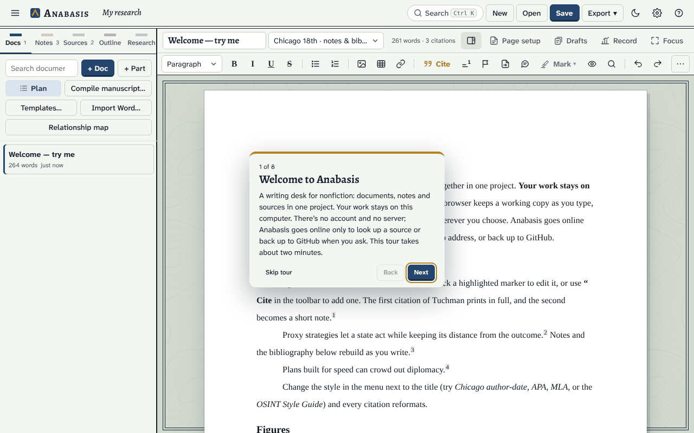

## 2. Start a project

Choose **New** in the top bar. Give the project a working title, pick what you’re writing, and choose a citation style. A word target and deadline are optional. Then choose **Create project**.

The kind of writing sets up a starting plan and turns on the checks that suit it. You can change all of it later.

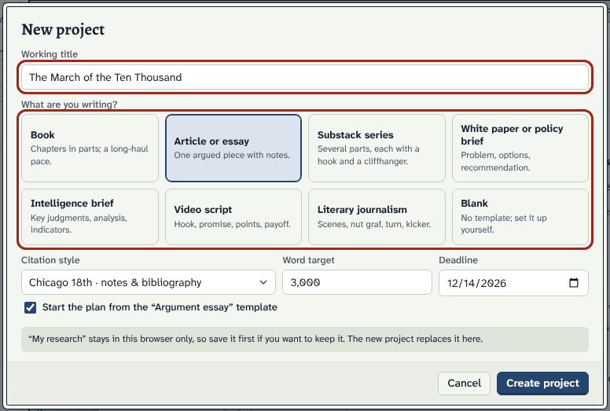

## 3. Write

Click in the page and start typing. Use the **Paragraph** menu at the left of the toolbar for headings: Heading 1 for the title, Heading 2 for sections. Anabasis keeps a copy in your browser as you type, so a closed tab never loses work.

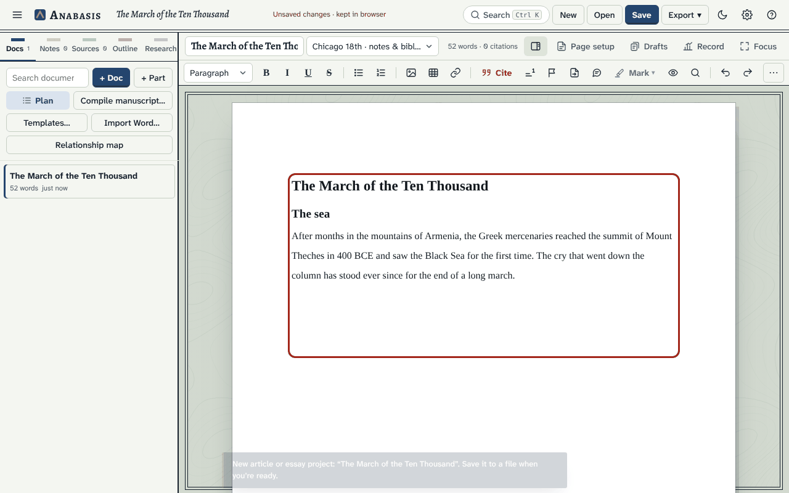

## 4. Add a source

Open the **Sources** tab in the sidebar.

- **The quick way:** paste a DOI, an ISBN or a web address into **Paste a URL, DOI or ISBN** and choose **Add**. Anabasis fills in the details for you.
- **By hand:** choose **+ New** and fill in the form on the right: type, people (author, translator, editor), title, publisher, place and date.

You can also import a whole bibliography from Zotero, BibTeX or RIS with **Import references…**.

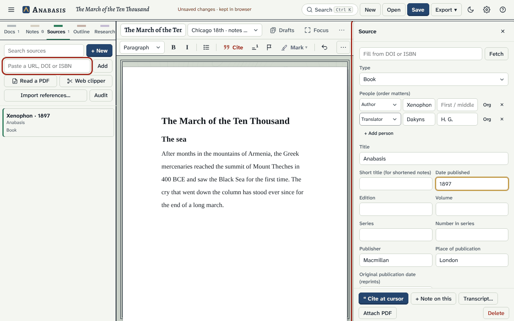

## 5. Cite as you write

Put the cursor where the citation belongs, at the end of a sentence. Choose **Cite** in the toolbar, pick the source, and add a page or other locator. The preview shows exactly how the note will print. Choose **Insert**.

To cite several sources in one note, pick more than one before you insert. To comment on the source in the same note, type in **Note text**: your words follow the citation (“Xenophon, *Anabasis*, IV.7. Where exactly Mount Theches stood is still debated.”). In author-date styles like APA, they become a numbered footnote instead.

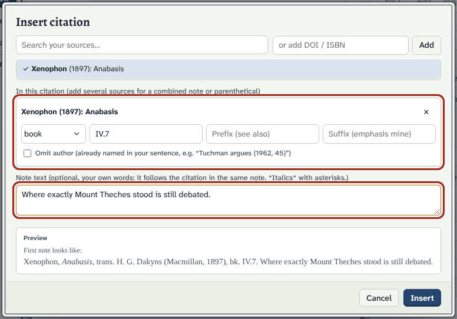

## 6. Watch the notes and bibliography build

Footnotes and a bibliography appear under your text and rebuild as you write. Second citations of the same source shorten automatically. In PDF and Word exports the notes become real footnotes at the foot of each page.

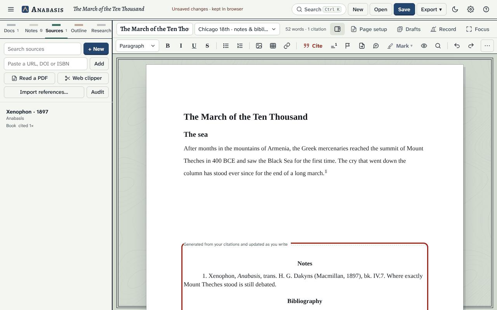

## 7. Switch styles at any time

The menu next to the document title sets the citation style: Chicago (notes, shortened notes or author-date), APA, MLA or the OSINT Style Guide. Change it and every citation, note and bibliography entry reformats at once.

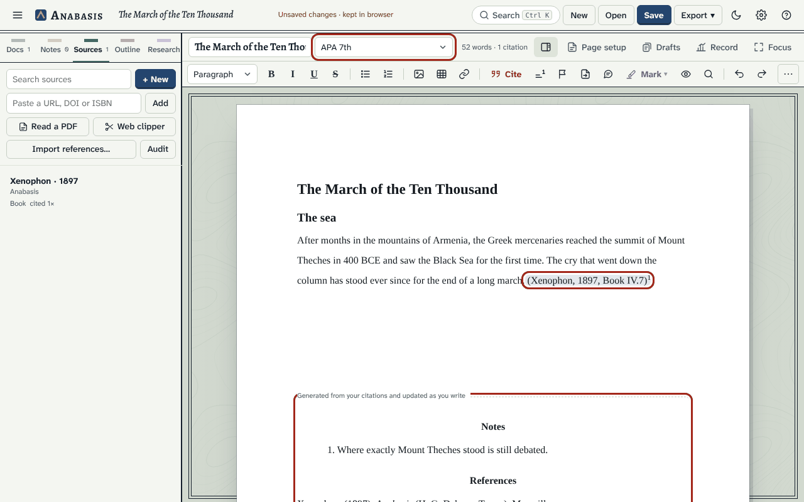

## 8. Keep notes and bring them in

Open the **Notes** tab and choose **+ New**. A note can be a quotation, a paraphrase, a summary or your own idea. Link it to a source and a page, and tag it.

To use a note in your draft, put the cursor where it goes and choose **Insert at cursor**, or drag the note onto the page. A quotation comes in with its quotation marks and its citation. Anabasis keeps track of it, so if the wording drifts from your note, the Outline tab tells you.

The **▦ Board** button lays your notes out as cards you can sort into piles before you draft.

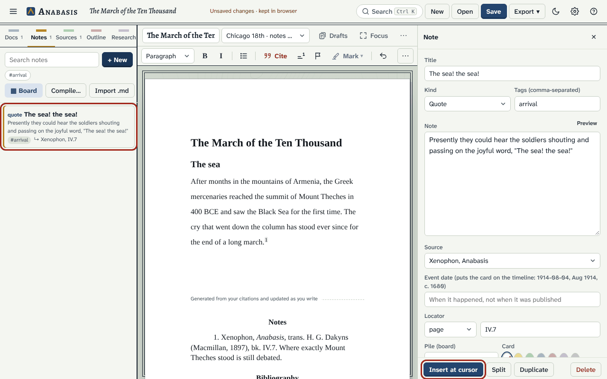

## 9. Check the draft

Open the **Outline** tab. Besides the outline of your headings, it reads over your shoulder:

- **Corroboration:** which paragraphs rest on a single source, and which source carries the piece;
- **Acronyms**, **house style** (numbers, dates, dashes, quotation marks, preferred spellings) and **accessibility** (alt text, heading order, link text);
- **Estimative language** for intelligence-style writing, and quotations that no longer match their notes.

Most problems have a one-click fix. Click a finding to jump to it in the text.

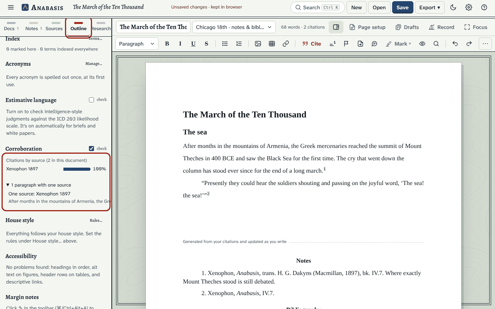

## 10. Mark what you'll come back to

Select a passage and choose **Mark** in the toolbar:

- **Claim to check** puts a sentence in the claims register. Anabasis finds the citation after it, and warns when a claim has no source, leans only on weak sources, or changed after you marked it supported.
- **Highlight in a thread** follows a theme or an argument through every chapter, in its own color.
- **Key for review** sets a passage to come back to by a date; **Link to a question** ties it to an open research question.

Click a marked passage to change it. The **Research** tab lists what's in this document and what's due, and **Research desk** reads a thread straight through, shows claims against sources, and gathers everything about a name. Marks never appear in exports.

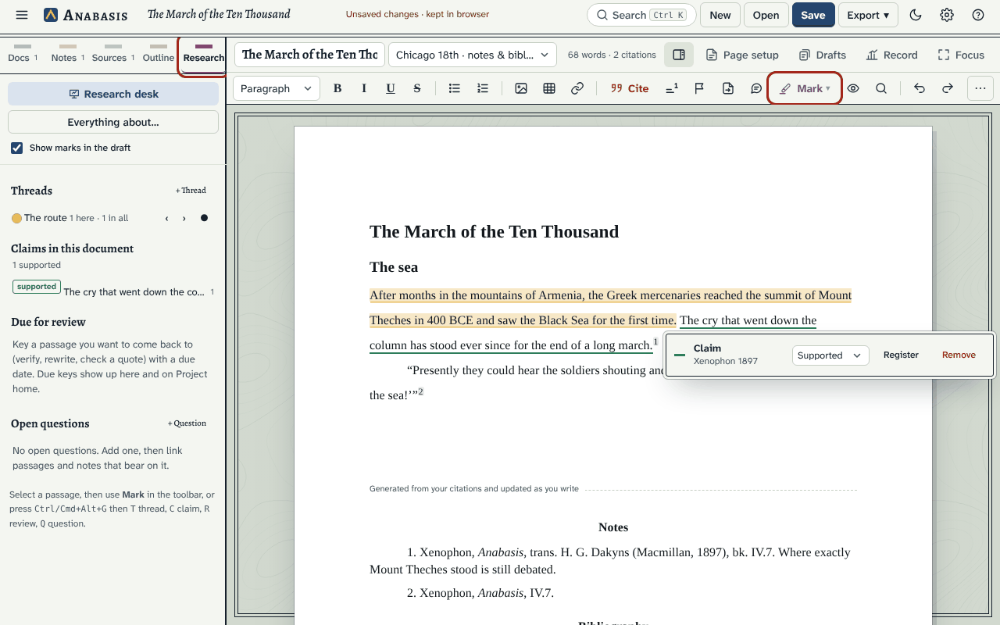

## 11. Save the project file

Choose **Save**. The first time, pick where to keep the project file, a single `.json` that holds everything: documents, notes, sources and images. Keep it somewhere that’s backed up, such as a synced folder.

In Chrome and Edge, later saves go straight back to the same file, and you can turn on autosave under Settings. Firefox and Safari download a fresh copy each time.

To pick up where you left off, choose **Open** and select the file.

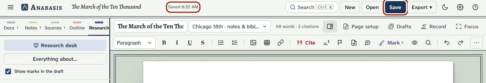

## 12. Export a PDF

Choose **Export**, then **PDF — print / save as PDF**. Anabasis lays the document out as pages with footnotes and opens your browser’s print window. Choose **Save as PDF** as the destination.

The same menu exports Word (with real footnotes), ePub, HTML, Markdown and a Substack-ready post.

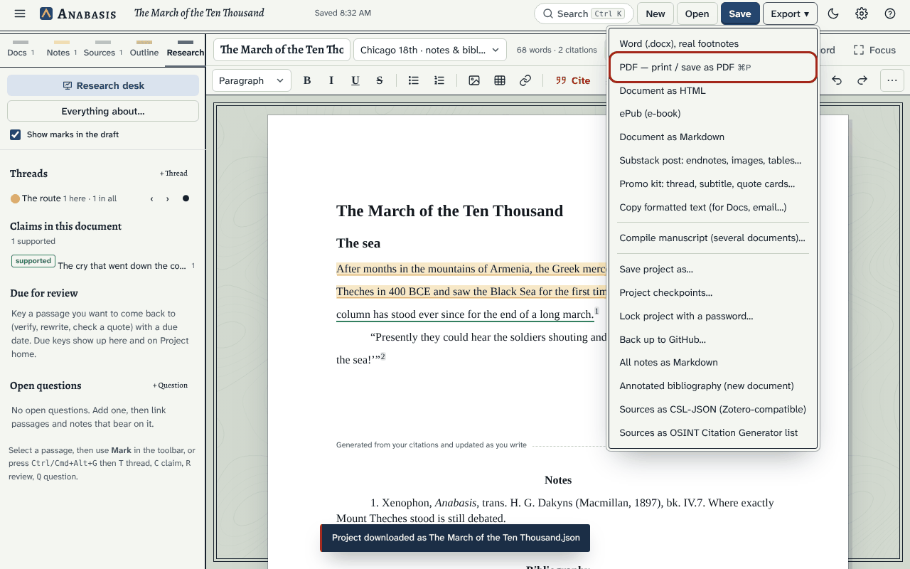

## Where to go next

- **Help** (the **?** button) explains every feature and can replay the tour.
- **Page setup** changes fonts, spacing, paper size and where notes go.
- **Drafts** saves named versions of a document you can compare side by side; **Export → Project checkpoints** saves the whole project.
- Read how Anabasis [handles your data](privacy.md), or the [project file format](file-format.md).

*The screenshots on this page are made by [`tools/guide/quickstart.py`](../tools/guide/quickstart.py), which drives the real app through these steps, so they match the current release.*
