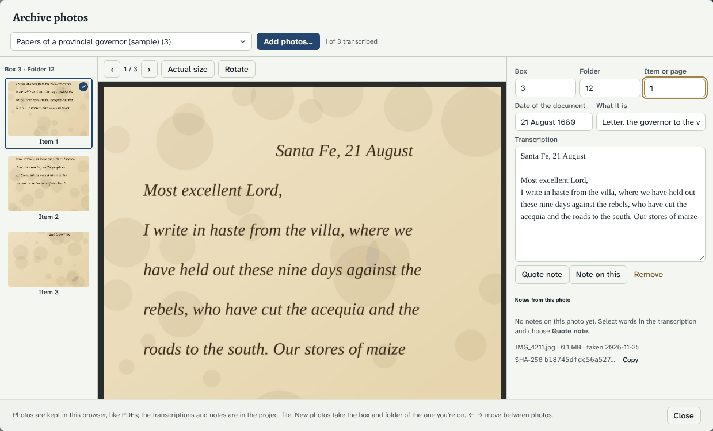

Most archive work today means photographing documents in the reading room and reading them properly later. **Archive photos** is the place for those pictures: filed by box and folder, transcribed beside the image, and turned into notes that cite where each document came from.

## Opening it

- **Photos…** at the foot of a source, for that source's photos.
- **Sources → Tools → Archive photos**.
- **Archive photos** in the command search (**Ctrl+K**).

## Collections

Photos belong to a source: usually the **collection** you're working in, such as "Papers of Henry Knox" or a ministry's files at a national archive. Choose the collection at the top, or **New collection…** to make a source for it (an archival item, marked primary). Add the archive's name and location in the source's details later; that's what your citations will use.

## Adding photos

Choose **Add photos…**, or drop pictures onto the viewer. JPEG and PNG work everywhere; HEIC photos from an iPhone work in browsers that can read them (Safari does), so you may want your phone to save JPEGs for archive trips.

- **New photos are filed under the box and folder of the photo you're on.** Set the box and folder on the first picture from a folder, then add the rest: they're filed in one go.
- **The same photo is never added twice.** Each file gets a SHA-256 fingerprint, and a picture that matches one already in the collection is skipped.
- Photos are resized to 2,400 pixels on their longest side, which keeps handwriting readable and the browser's storage manageable. The fingerprint is of the original file, so you can show later that a copy is the one you took.

## Filing and transcribing

For each photo, fill in:

- **Box**, **Folder** and **Item or page**, as the archive numbers them;
- **Date of the document**, when it was written (not when you photographed it);
- **What it is**: "Letter, Otermín to the viceroy", "Muster roll", "Minutes of the council".

Then type the **transcription** beside the image. A few conventions help later:

- mark doubtful readings with **[?]**, as in "Santa Fe [?]";
- mark gaps and illegible words with **[…]**;
- keep the original spelling, and add [*sic*] only where a reader might think it's your error.

The strip on the left groups photos by box and folder, and ticks the ones you've transcribed. **← →** move between photos. **Actual size** shows the image at full resolution for hard-to-read hands, and **Rotate** turns a sideways photo.

### Read the text

For a typed or printed document, **Read the text** beside the transcription reads the photo on this computer and fills in the transcription, for you to correct against the image. Nothing is sent anywhere. It reads English, and handwriting comes out poorly, so it's a start for a typescript or a printed page rather than a substitute for reading.

## Notes from a photo

- Select words in the transcription and choose **Quote note**. The note quotes them and cites the collection, with **"box 3, folder 12, item 4"** as its locator. Chicago style prints that after the collection's details, as archival citations usually do.
- **Note on this** starts a note of your own about the photo.

Notes made from a photo are listed under it, and they're ordinary notes: tag them, [code](Literature-Grid-and-Codes) them, put them on the board, or drag them into a draft.

## Where the photos are kept

Like PDFs, **the images are kept in this browser, not in the project file**, so your project file stays small enough to save, send and back up. The project file keeps everything else: the box and folder, the transcription, the notes, and each original's fingerprint.

That means:

- **On another computer or browser**, the transcriptions and notes are there, but the images aren't. Add the photos again and they come back.
- **Start fresh → Erase everything** removes stored photos.
- **Keep your original photos** in a folder of their own, alongside your project file, as you would the PDFs.

## Tips for an archive visit

- **Photograph the folder label first**, then the documents in order. It's the easiest way to keep track of where each one came from.
- **Photograph every page you might need.** Reading-room time is short; reading can happen later.
- **Log the folders you looked at and found nothing in.** A dead end in the research journal saves you a second trip.
- **Transcribe within a week or two**, while you still remember the room, the order of the folder, and what you were looking for.

The research guide in the journal has a fuller guide to archival research, from finding aids to reading documents against the grain. See [The research journal](Research-Journal).

## Related pages

- [Sources](Sources)
- [Reading PDFs](Reading-PDFs)
- [Literature grid and codes](Literature-Grid-and-Codes)
