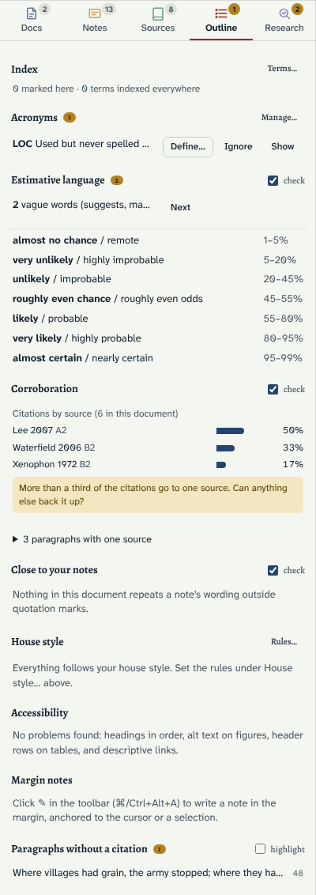
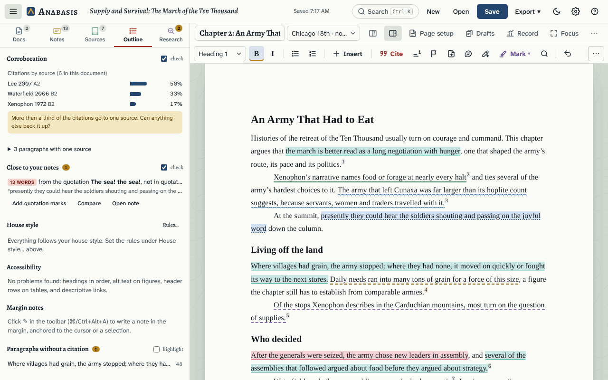
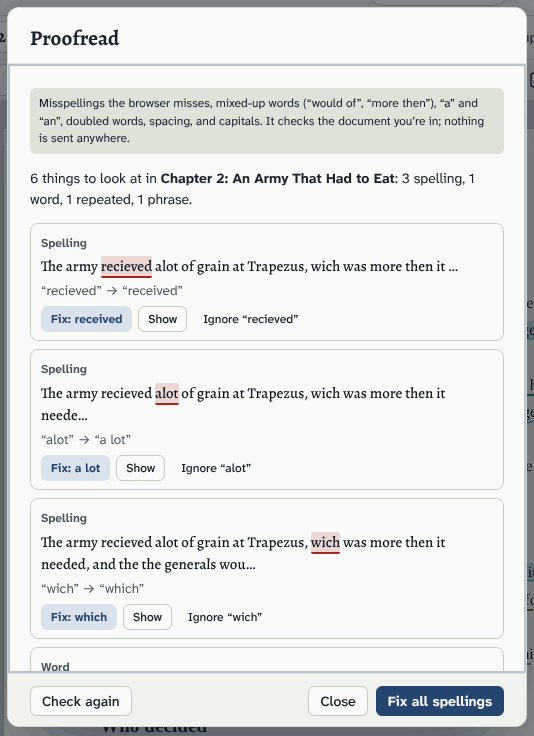

Anabasis reads over your shoulder. Most of its checks live in the **Outline** tab, where each finding is a link to the place in the text, and most have a one-click fix. Proofread and the revision lens work on the document you’re in. None of them send your text anywhere: every check runs in the page.

This page goes through them roughly in the order you’d use them, from loose ends in a first draft to the last pass before you send it out.

## Flags: what’s still to do

While drafting, leave a flag wherever something’s missing rather than stopping to look it up. The flag button in the toolbar (**Ctrl+Shift+K**) offers three:

- **TK**: a fact to fill in (“TK” is the old printers’ mark for *to come*). Typing the letters TK in the text counts too.
- **cite?**: a citation to find.
- **check**: something to verify.

**Outline → To resolve** lists every flag in the document. **Loose ends** on Project home lists them across the whole project, and the Oracle answers “any TKs?”. Click an item to jump to it.

## Paragraphs without a citation

**Outline → Paragraphs without a citation** lists paragraphs of 40 words or more with no citation in them. Tick **highlight** to mark them in the text. Not every paragraph needs a source, but in research writing it’s a quick way to find the ones that should have one.

## Close to your notes

**Outline → Close to your notes** finds sentences in the draft that repeat a note’s wording without quotation marks: seven or more words in a row from a quote note, or nine from a paraphrase or summary note. It’s the most common way copied wording ends up reading as your own, often by accident, from notes taken quickly months ago.

- **Add quotation marks** puts the passage in quotation marks and, if the paragraph doesn’t already cite the note’s source, adds the citation with the note’s page.
- **Compare** shows your sentence and the note side by side, with the shared words marked, so you can rewrite the sentence in your own words instead.
- **Open note** shows the note. If a “paraphrase” note turns out to be the source’s own words, change it to a quote note.

Words already inside quotation marks are never flagged, and nor are your own **idea** notes. The check runs in the page, against your own notes; nothing is sent anywhere.

## Proofread

Press **F7**, or choose **Proofread** in the toolbar’s **⋯** menu or the command search (**Ctrl+K**). Proofread checks the document you’re in for the mistakes a browser’s spell checker misses:

- **About 400 common misspellings**: *recieve*, *seperate*, *alot*, *wich*, *teh*.
- **Mixed-up words**, where they’re almost always wrong: *would of*, *more then*, *your welcome*, *to loose*, *an affect on*, *for all intensive purposes*, *calvary* charging beside the infantry.
- **“A” and “an”** by the sound of the next word, not its first letter: *an hour*, *an FBI briefing*, *a unit*, *a European*.
- **Doubled words**: *the the*.
- **Spacing around punctuation**: a space before a comma, none after a full stop, two spaces in a row.
- **Capitals after a full stop**, without tripping on *e.g.*, *i.e.* or *et al.*, and a lowercase *i* on its own.
- **Brackets and quotation marks left open.**

Each finding shows the sentence it’s in, with the fix. **Fix** mends one; **Fix all spellings** mends every misspelling at once (mixed-up words are left for you to check one by one, since context matters); **Ignore** keeps a word out of Proofread for the whole project, which is handy for names and technical terms. **Check again** reruns it. Fixes keep the text’s formatting, so a misspelled word in italics stays in italics.

Proofread is deliberately cautious. It flags things that are almost always wrong and leaves judgment calls alone. It isn’t a grammar checker, and it doesn’t rewrite your sentences. The browser’s own spell checker still underlines unknown words as you type.

## The revision lens

**Revision lens** in the toolbar highlights, in the document you’re in:

- **long sentences** of 35 words or more;
- **passive voice**;
- **hedges and filler**: *arguably*, *quite*, *rather*, *very*, *basically*, *it seems*, *in order to*, *it is important to note*;
- **repeated words** close together;

and shows the document’s reading grade level. Use it on a second draft, when the sentences are worth tightening. Not every long sentence or passive is a fault; the lens shows where to look.

## Listening to the draft

**Listen** in the document bar reads aloud from the cursor, highlighting each sentence. Hearing a draft catches what reading it doesn’t: repeated words, missing words and sentences that run on. Pause, skip a sentence either way, and change the speed or voice in the bar above the page; typing pauses it. Citations and note numbers are skipped unless you tick **Read note numbers and citations**. The voices are your system’s own, so nothing leaves the computer (a voice marked “online” is the exception).

## Quotes

**Outline → Quotes** checks quotations against the notes they came from. A quotation inserted from a quote note stays linked to it, and if the wording in the draft drifts, it’s flagged. **Compare** shows the difference; restore the original, or update the note if the note was wrong. Ellipses (…) and [bracketed changes] count as legitimate edits. Long quotations typed or pasted without a note are listed as *unlinked*.

## Names and spellings

**Names & spellings** (Docs tab, or **Outline → Names & spellings**) keeps a list of people, organizations, places and terms with their preferred spelling and the variants to watch for. Variants in the draft (*Kiev*, *Prigozin*) are highlighted and fixable in one click. Anabasis also suggests near-duplicate spellings it finds in the project, such as two spellings of the same name in different chapters.

The names list also feeds the index, the relationship map and **Everything about…** on the research desk.

People named in the draft whose **consent** is recorded as pending, declined or withdrawn are flagged here too, with whether exports will use their pseudonym. See [Exporting](Exporting#pseudonyms).

## Acronyms

**Outline → Acronyms** learns acronyms when you spell them out (“the Islamic Revolutionary Guard Corps (IRGC)”) and flags any that are used before they’re defined, defined twice, defined late or used only once. One click fixes each. A List of Abbreviations fills itself in on export if you add one.

## Estimative language

**Outline → Estimative language** is on automatically for intelligence briefs and white papers, and you can turn it on for any document. It underlines vague words such as *may*, *could* and *possibly*, and offers terms from the ICD 203 likelihood scale instead, from *almost no chance* (1–5%) through *roughly even chance* (45–55%) to *almost certain* (95–99%). It also flags sentences that mix confidence and likelihood, wordings from different scales in one sentence, and Key Judgments with no confidence level.

## Corroboration

**Outline → Corroboration** lists paragraphs that rest on a single source, and paragraphs that rest only on sources rated D–E for reliability or 4–5 for credibility. It shows which sources carry the most citations, and warns when one source carries more than a third of them. It’s the check that tells you whether a piece stands on its evidence or on one book.

Rate sources in their details to get the most from it. See [Sources](Sources).

## House style

**Outline → House style** checks a document against rules you choose (**Rules…**):

- **numbers**: spell out one to nine (AP and most news style), or up to one hundred (Chicago);
- **percent**: *12 percent* or *12%*;
- **United States**: *U.S.* or *US*;
- **the serial comma**: use it (red, white, and blue) or drop it (red, white and blue);
- **dates**: February 24, 2022, or 24 February 2022;
- **em dashes**: closed—like this, or spaced — like this;
- **ellipses**: one character (…) or spaced periods (. . .);
- **curly quotes and apostrophes**, and **no double spaces**;
- and **preferred spellings**, one per line, such as `Kyiv = Kiev`.

Any rule can be set to *Don’t check*. Each rule has a **Fix all** button. The rules are saved with the project, so a co-writer working from a copy uses the same ones.

## Accessibility

**Outline → Accessibility** flags figures without alt text, headings that skip a level, tables without a header row, and links that say “here” or show a bare address. Exporting to a web page, an e-book or Word reminds you if anything’s left.

## Checking claims

For a piece where every factual statement has to stand up, mark claims as you go with **Mark → Claim to check** (**C**). The claims register finds the citations inside or right after each claim, and warns when a claim has no source, rests only on weak sources, or was edited after you marked it supported. The **fact-check sheet** prints the register as a checklist with full citations, and the **evidence grid** lays claims against sources. This gets its own page soon; meanwhile, Help covers it under *Research*.

## Find and replace in all documents

**All documents…** in the find bar (**Ctrl+F**), or the command search, searches every document and, if you like, your notes. Tick the matches to change. Citations and footnotes are never touched, and each changed document gets a safety copy in Drafts first.

## Before you send a draft out

A last pass, in about ten minutes. The research guide in the journal has a fuller **Before you submit** checklist you can tick off, saved with the project.

1. **Outline → To resolve** is empty, and **Close to your notes** finds nothing.
2. **Proofread** (F7) finds nothing you haven’t ignored on purpose.
3. **Corroboration** has no single-source paragraph you can’t defend.
4. **House style → Fix all** for the rules you use.
5. **Accessibility** is clear, if it’s going to the web or an e-book.
6. **Sources → Tools → Source audit** shows no sources missing details.
7. Save a **draft** (Drafts in the document bar) named for where it’s going, such as “Sent to editor”, so you can compare later.

## Related pages

- [Sources](Sources)
- [Exporting](Exporting)
- [Citations and styles](Citations-and-Styles)
