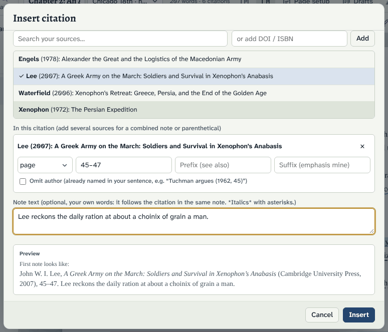
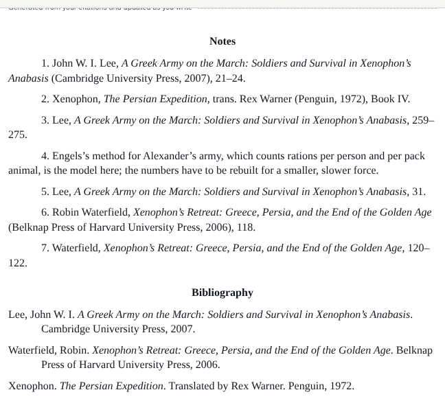

Anabasis formats citations with citeproc-js, the same engine Zotero and Mendeley use, and the Citation Style Language styles that go with it. You cite as you write; the notes and bibliography build themselves under the text, and you can change the style at any time without touching a single citation by hand.

## Citing as you write

1. Put the cursor where the citation belongs, usually at the end of a sentence or clause.
2. Choose **Cite** in the toolbar, or press **Ctrl+Alt+C** (**⌘⌥C**).
3. Pick a source from the list. Type to filter it by author, title or year.
4. Add a **locator**: the page, or another part of the work.
5. Check the **preview**, which shows exactly how the citation will print in the document's style.
6. Choose **Insert**.

If the source isn't in the project yet, add it in the **Sources** tab first (see [Sources](Sources)). The citation window lists only sources already in the project.

### Locators

A locator says where in the source you're pointing. Choose its kind from the menu beside the box: page, timestamp, chapter, section, paragraph, line, figure, table, volume, part, note, column, folio, verse or book. Each style abbreviates them its own way, so type just the number or range (`45–47`, `IV.7`, `00:12:30`) and let the style add "p." or "pp." where it should.

A **timestamp** suits interviews, podcasts and video. Transcript notes fill it in for you (see [Notes and the board](Notes-and-the-Board)).

### More than one source in a citation

Pick more than one source before you insert to make a combined note or parenthetical: "(Lee 2019, 12; Waterfield 2006, 88)". Each source has its own locator. Use **↑** to change the order, and **✕** to take one out.

### Prefix, suffix and omitting the author

Each source in a citation also has:

- a **prefix** that prints before it, such as "see also" or "cf.";
- a **suffix** that prints after it, such as "emphasis mine";
- **Omit author**, for author-date styles when your sentence already names the author: "Tuchman argues (1962, 45)".

### Note text: your own words in the note

**Note text** adds your own words to the note, after the citation:

> Xenophon, *Anabasis*, IV.7. Dakyns places the mountain farther east.

Use `*asterisks*` for italics. In note styles (Chicago notes and bibliography, OSINT and the like) the words follow the citation in the same footnote. In author-date styles (APA, MLA, Chicago author-date, Harvard), the parenthetical stays in the text and your words become a numbered footnote. Either way they carry through to Word and PDF footnotes, and to e-book, web page, Markdown and Substack notes.

### Editing or removing a citation

Click any citation (or its note number) to open it again. Change the sources, locators or note text, or choose **Remove citation**. Notes renumber themselves.

## Footnotes that aren't citations

The **footnote** button in the toolbar adds a note in your own words, with no source. Text footnotes share numbering with citation notes. For anything with a source, use **Cite** instead, so the source is formatted properly and goes into the bibliography.

## The notes and bibliography

Notes and the bibliography appear under the text and rebuild as you write:

- **Ibid. and short forms** are handled for you. The first citation of a source is in full; later ones are shortened as the style requires, and styles that use ibid. use it.
- **The bibliography** lists every source cited in the document, sorted and formatted by the style. Its heading follows the style too: Bibliography, References or Works Cited.
- **The OSINT Style Guide** has no bibliography, as the guide specifies.

In PDF and Word exports the notes become real footnotes at the foot of each page. In e-books they're tappable. In a compiled manuscript, notes number continuously across chapters and short forms carry from one chapter to the next.

**Page setup** in the document bar has options for the bibliography, such as **Group by source type**, which splits it into primary, secondary and tertiary sources.

## Choosing a style

The menu next to the document's title sets its citation style. Change it and every citation, note and bibliography entry reformats at once. Each document has its own style, so a project can hold a Chicago chapter and an APA article side by side.

There are 55 styles, grouped by field:

- **Most used:** Chicago 18th notes and bibliography, shortened notes and bibliography, and author-date; APA 7th; MLA 9th; OSINT Style Guide v1.5.
- **Humanities and history:** Chicago 18th with ibid., with archives cited place first, and with an annotated bibliography; Chicago 17th notes and author-date; MLA 9th with notes and annotated; MHRA 4th notes and author-date; New Hart's Rules notes and author-date; Oxford Guide to Style; SBL 2nd.
- **Social sciences:** APA 6th and APA 7th annotated; APSA; American Journal of Political Science; International Studies Association; ASA; American Anthropological Association; Harvard (Cite Them Right, Anglia Ruskin, SAGE and Elsevier); Taylor & Francis Chicago author-date.
- **Law:** OSCOLA 4th; Bluebook law review (notes) and inline.
- **Sciences and medicine:** AMA 11th; NLM/Vancouver; CSE 9th citation-sequence and name-year; Nature; Science; Cell; The Lancet; BMJ; ACS; Royal Society of Chemistry; American Physical Society; AIP; AGU; Springer author-date and numeric; Elsevier numeric.
- **Engineering and standards:** IEEE; ASCE; ISO 690 author-date and numeric.

### Titles and capitalization

Type titles the way they should print in the style you use most. Citation styles can't reliably convert title case to sentence case (which APA wants for article and book titles), because they can't tell a proper noun from an ordinary word. If you switch a document from Chicago to APA, look over the bibliography for titles that need lowercasing.

## The OSINT Style Guide

Choose **OSINT Style Guide v1.5** for open-source intelligence and investigative work. Citations become footnotes in the guide's form, built by the OSINT Citation Generator's own formatter: the full form the first time, a short form after.

- Open a source and expand **OSINT Style Guide details** to set the description (from the guide's library of 771 terms), details, qualifiers, access notes, rating, language, archive copy and commentary. The preview shows the finished footnote along with the generator's own warnings.
- Anything you leave blank is filled from the source's regular fields: authors, title, container as location, date, and URL or DOI.
- Type **See**, **Cited in** or **Quoted in** as a citation's prefix to open the footnote with it. The suffix becomes commentary after the citation.
- **Import…** in the Sources tab opens list files saved by the [OSINT Citation Generator](https://zerohistory.net/tools/cites/), and **Export → Sources as OSINT Citation Generator list** writes one back.

## Citing in Pandoc, Quarto and LaTeX

If the writing will finish somewhere else:

- **Export → Pandoc / Quarto package** gives the document as Markdown with citations as `[@key, p. 12]`, its bibliography file and the citation style file, ready for `pandoc --citeproc`.
- **Export → LaTeX package** gives a `main.tex` with BibLaTeX `\autocite` commands and a `.bib` file, ready for Overleaf or `latexmk -xelatex`.

Each source gets a readable key such as `tuchman1962guns`. See [Exporting](Exporting).

## Tips

- **Cite while you draft, not afterwards.** A citation takes a few seconds as you write, and the [checks](Checking-the-Draft) can then tell you which paragraphs have no source or lean on only one.
- **Use `cite?` when you don't have the source to hand.** The flag button (**Ctrl+Shift+K**) leaves a marker that's listed under Outline and on Project home until you resolve it.
- **Turn a passage you quote into a note first.** A quotation inserted from a quote note carries its citation and stays linked to the note, so Anabasis can tell you if the wording drifts.

## Related pages

- [Sources](Sources)
- [Notes and the board](Notes-and-the-Board)
- [Exporting](Exporting)
