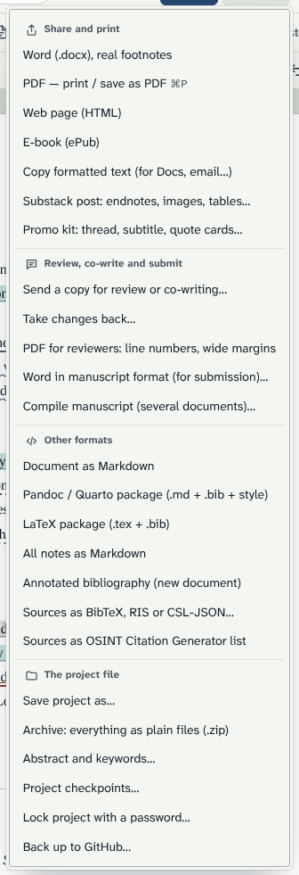
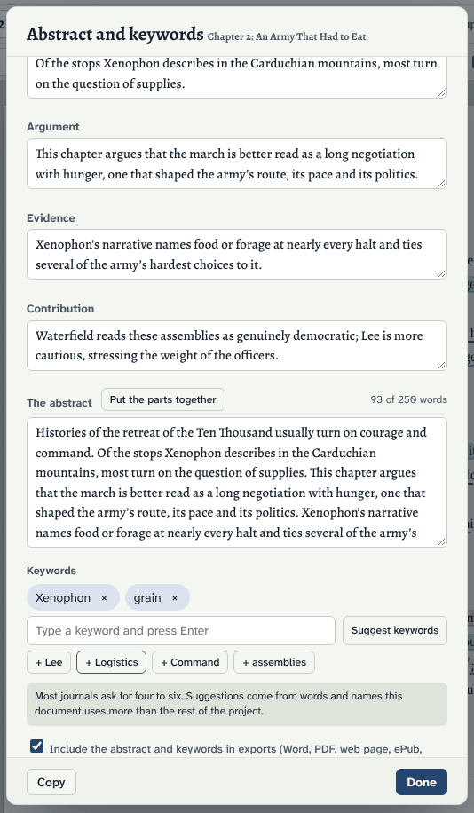

The **Export** menu turns a document into whatever comes next: a Word file for an editor, a PDF to print, an e-book, a Substack post, or Markdown, Pandoc and LaTeX for other tools. Citations, footnotes, figures, tables, equations and cross-references carry through to every format. This page covers each export, the settings that shape them, and the abstract and keywords.

The menu is grouped by what you're doing:

- **Share and print**: Word, PDF, web page, e-book, formatted text, Substack, promo kit.
- **Review, co-write and submit**: send a copy, take changes back, the reviewer PDF, manuscript format, compile.
- **Other formats**: Markdown, Pandoc, LaTeX, notes, the annotated bibliography and your sources.
- **The project file**: save as, the plain-file archive, the abstract and keywords, checkpoints, lock and GitHub backup. See [Projects, saving and privacy](Projects-and-Saving).

Each export works on the document that's open. To put several documents together, use **Compile manuscript** (below).

## Page setup: how exports look

**Page setup** in the document bar controls the exported page, separately from how the page looks on screen (that's in Settings):

- the **title block** (author, date, and a subtitle, course or publication line), with a button for the **abstract and keywords**;
- **font** (book serif, Times or sans-serif), **size** (11, 12 or 13) and **line spacing** (single, 1.5 or double);
- **paper** for PDFs: US Letter or A4;
- **the bibliography**: only sources cited, every source in the project, or none, and whether to group it by source type;
- the document's **word target**, and whether it's front matter, a chapter or back matter in a manuscript;
- **PDF notes**: footnotes at the foot of each page, with running heads (book style), or endnotes collected before the bibliography;
- **Add an index** (PDF, Word, ePub and web page);
- **This is a video script**, for run time and timecodes;
- what happens to **margin notes**: Word comments in Word files, a separate Marginalia page at the end, or left out;
- **indented first lines** and **page numbers** in PDFs.

Settings controls only what you see while you write, so a double-spaced manuscript doesn't have to read double-spaced on screen.

## Share and print

### Word (.docx)

Word files have **real footnotes** that Word numbers and lays out itself, a proper bibliography, figures with captions, tables, and headings Word recognizes as headings (so its navigation pane and table of contents work).

- **Suggestions** you've made in Suggest mode go in as **tracked changes**, and **margin notes** as **Word comments**.
- **Equations** go in as Word equations, editable in Word's equation editor; numbered ones keep their numbers.
- **Cross-references** are links to the caption, equation or heading.
- **An index**, if you add one, goes in as Word index fields that build when Word opens the file.

Coming back the other way, **Import Word** (Docs tab) brings in a `.docx` with its footnotes, images, tables and equations, and turns an editor's tracked changes into suggestions and their comments into margin notes on the same words.

### PDF

**PDF — print / save as PDF** (**Ctrl+P**) lays the document out as pages, with footnotes at the foot of each page, then opens your browser's print window. Choose **Save as PDF** as the destination. The PDF has real, selectable text. Book-style PDFs have running heads, and a list of figures or an index, if you add them, gets real page numbers. Page setup can collect the notes as endnotes instead.

### Web page (HTML)

One self-contained `.html` file, with notes as links, figures inside the file, and equations drawn sharply at any size. It's a good format for sending a draft to someone who doesn't have Word, or for publishing.

### E-book (ePub)

An ePub with tappable notes, a table of contents from your headings, figures, and equations that scale. It opens in Apple Books, Kobo, Calibre and most readers. (Kindle reads ePub when sent through Send to Kindle.)

### Copy formatted text

Copies the document to the clipboard with its formatting and notes, to paste into Google Docs, an email or a content management system.

### Substack post

Copies the document ready to paste into Substack's editor. Notes become a numbered **Notes** section with links, figures stay images, and tables are drawn as images, because Substack has no tables. Equations come as TeX in dollars, to paste into Substack's equation block. **The .zip package** has the post and every image, in case something doesn't paste.

### Promo kit

Drafts what goes around a published piece: a numbered thread for X, Bluesky, Threads, Mastodon or LinkedIn with a counter on every post, a Substack subtitle and search description, and **quote cards** (square, wide or portrait) as PNG images.

## Review, co-write and submit

### Send a copy and take changes back

**Send a copy for review or co-writing…** saves a copy of the whole project as a file, with a note for your collaborator. They open it in Anabasis (the web page or the downloaded file; no account), work as usual, save, and send the file back. **Take changes back…** compares their file with what you sent and what you've written since: their edits come in as suggestions under their name, ready to accept or reject, and their notes, sources, margin notes and images are added. Where you both changed the same paragraph, you see the two side by side and choose. Everything passes through files you send yourself; nothing goes through a server.

### PDF for reviewers

Numbers every line (starting again on each page), widens the outer margin for handwritten notes, and marks each page "Review copy" with the date, so comments can say "p. 4, line 12".

### Word in manuscript format

Sets what agents and editors expect: Times New Roman 12, double-spaced, one-inch margins, indented paragraphs, `#` for section breaks, "Surname / Short title / page" at the top of each page after the first, and a first page with your name, contact details, rounded word count, title and byline. Footnotes stay; margin notes are left out. Your contact details are kept in this browser's settings, never in the project file.

### Compile manuscript

**Compile manuscript…** joins documents in binder order into one Word file, Word in manuscript format, PDF, reviewer PDF, Markdown, ePub, HTML or a new document in the project. Choose which documents to include, the manuscript's title and its citation style. Notes number continuously, short forms carry across chapters, and figures and cross-references are renumbered for the whole book, so a chapter's Figure 1 becomes whatever it is in the manuscript.

## Other formats

### Markdown

The document as Markdown, with `[^1]` footnotes that Obsidian and most Markdown tools understand, and equations as `$…$` and `$$…$$`.

### Pandoc / Quarto package

The document as Markdown with citations as `[@key, p. 12]`, its bibliography (`.bib`) and its citation style (`.csl`), ready for `pandoc --citeproc` or Quarto. Use it when the writing will finish in a journal's own pipeline.

### LaTeX package

A `main.tex` with BibLaTeX `\autocite` commands, `\ref` and `\label` for cross-references, `equation` environments for numbered equations, and the `.bib` file, ready for Overleaf or `latexmk -xelatex`.

### Notes, the annotated bibliography and sources

- **All notes as Markdown** writes every note to one Markdown file.
- **Annotated bibliography** makes a new document from each source's Annotation field.
- **Sources as BibTeX, RIS or CSL-JSON…** for Zotero, EndNote, Mendeley or JabRef; all sources, or only those cited in the open document.
- **Sources as OSINT Citation Generator list**, to audit them in that tool.

## The abstract and keywords

**Abstract and keywords…** (Export menu, under *The project file*, or the button at the top of **Page setup**) builds an abstract a part at a time, then lets you read it as a whole. It's kept with the document and, while **Include** is on, goes under the title in every export.

### Building the abstract

1. Choose the **kind of piece**. Each has its own parts:
   - **Research article**: background, aim, method, findings, conclusion.
   - **Essay or chapter**: context, question, argument, evidence, contribution.
   - **Report, brief or white paper**: purpose, scope, findings, recommendations.
   - **Write it whole**: no parts, one box.
2. Write a sentence or two for each part. Each box says what the part is for.
3. Or choose **Suggest from the draft**, which fills the empty parts with sentences you've already written that sound like each part: a sentence that begins "This chapter argues" for the argument, one with "drawing on" or "archives" for the method. They're your own words, to rewrite as a summary; Anabasis doesn't write anything for you.
4. **The abstract** shows the parts put together. Edit it there as a whole once the parts are right; **Put the parts together** rebuilds it from the parts.
5. Set the **word limit** (100 to 350 words, or none). The count turns red when you're over.

### Keywords

Type a keyword and press **Enter**, or choose **Suggest keywords**: the names and terms this document uses more than the rest of the project, so a chapter on supply gets *grain* and *Trapezus*, not *army*. Click a suggestion to add it. Most journals ask for four to six.

### Where they go

With **Include** on, the abstract and keywords go under the title in Word (as their own paragraphs), PDF, web page, ePub and Markdown, in the Pandoc package's front matter, and in LaTeX's `abstract` environment. **Copy** copies them to paste into a journal's submission form.

## Pseudonyms

When people you interviewed or write about asked not to be named, keep their real names in your project and let the exports change them.

1. In **Names & spellings** (Docs tab, or **Outline → Names & spellings → Manage…**), add the person with their real name.
2. Give them a **Pseudonym**, and list **Other forms to replace**: a surname on its own, a first name, a nickname.
3. Make sure **Use pseudonyms in exports** is ticked.

Every export (Word, PDF, web page, e-book, Markdown, Pandoc, LaTeX, Substack, copy formatted text) then uses the pseudonym for every form of the name, including in footnotes, captions and alt text. The draft, your notes and the project file keep the real names.

Record each person's **consent** in the same row: given, asked and not yet answered, declined, withdrawn, or not needed for a public figure. Anyone named in a draft whose consent is pending, declined or withdrawn is flagged in the Outline, so it's checked before the piece goes out.

A pseudonym replaces a name, not the details around it. Someone can still be recognized from their job, town or story; read the draft for those too.

## Accessibility reminders

Exporting to a web page, an e-book or Word reminds you if the **Accessibility** check found anything: figures without alt text, skipped heading levels, tables without a header row, or vague link text. See [Checking the draft](Checking-the-Draft).

## Tips

- **Send Word to editors, PDF to readers.** Word keeps your notes, suggestions and comments editable; PDF looks the same everywhere.
- **Save a draft before you send.** **Drafts** in the document bar keeps a fixed copy named for where it went, so you can compare what comes back.
- **Keep the archive for the long term.** Formats change; plain Markdown and BibTeX in a zip will still open in twenty years.

## Related pages

- [Projects, saving and privacy](Projects-and-Saving)
- [Citations and styles](Citations-and-Styles)
- [Checking the draft](Checking-the-Draft)
