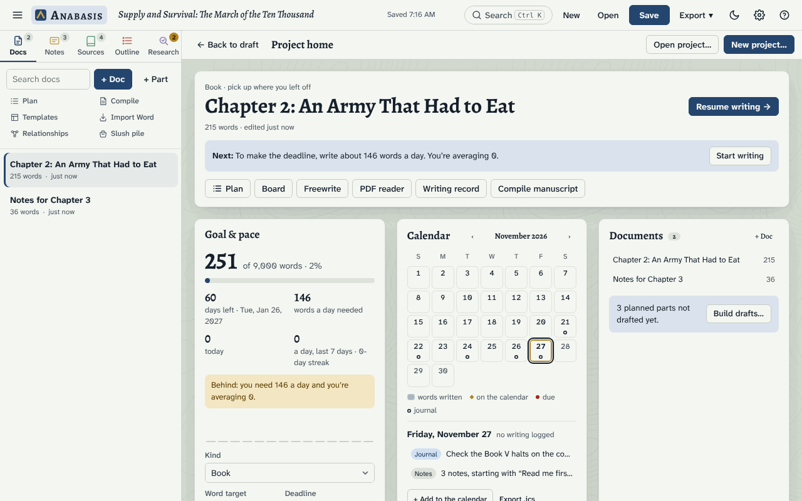
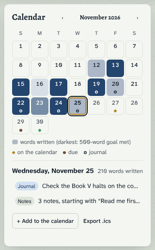
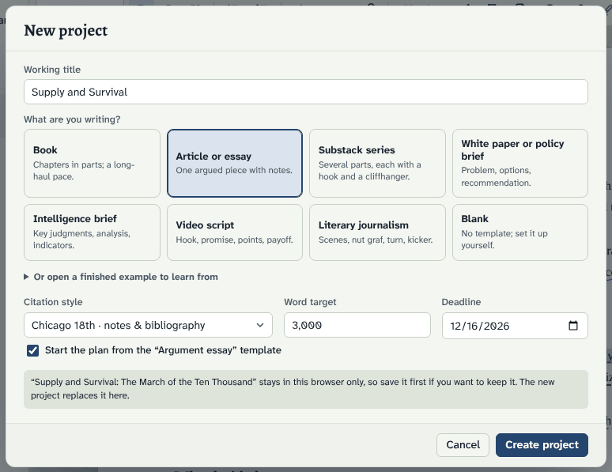
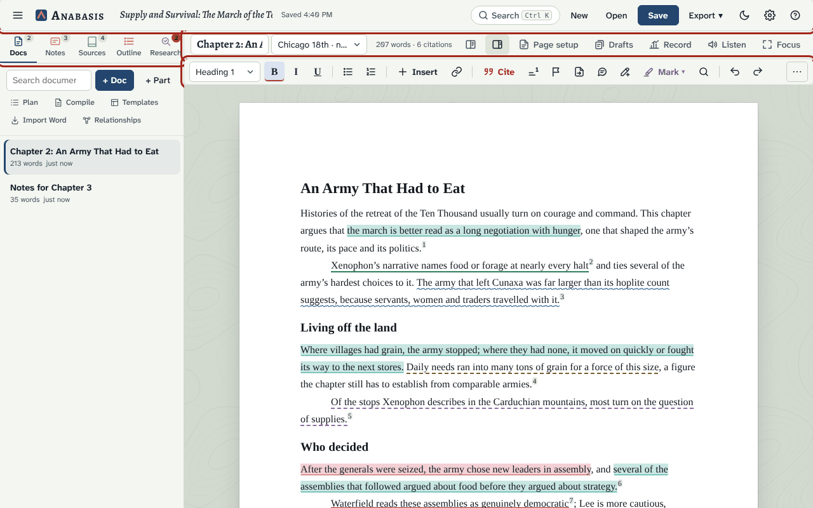

This page covers opening Anabasis for the first time, starting a project, and finding your way around the screen. If you'd rather follow one short piece of writing from a blank page to a PDF, the [quick start](https://github.com/gmichaelrapp/anabasis/blob/main/docs/quick-start.md) does that in twelve steps.

## Two ways to open it

Anabasis is one HTML file. You can use it in either of two ways, and they behave the same:

- **Download it.** Get `anabasis.html` from the [latest release](https://github.com/gmichaelrapp/anabasis/releases/latest) and open it in your browser. It runs from your disk, with no internet connection needed. Each release lists a SHA-256 checksum if you want to confirm the file is the one that was published.
- **Use the hosted copy** at [zerohistory.net/anabasis/app/](https://zerohistory.net/anabasis/app/). It's the same file served from a web address. Your work still stays in your browser; nothing you write is sent to the site. The hosted copy updates itself when a new version comes out, and it's the one to use for the web clipper and for adding Anabasis to a phone's home screen.

A browser keeps a separate working copy for each address it opens Anabasis from. A downloaded file, the hosted copy and a home-screen app each have their own. To move work between them, save your project file in one and open it in the other.

### Which browser

Current desktop **Chrome**, **Edge**, **Brave** or another Chromium browser works best. These can save straight back to the same project file, remember recent files, and autosave to the file a few seconds after you stop typing.

**Firefox** and **Safari** work too. Saving downloads a fresh copy of the project file each time, and a few highlights from the checks show only in their lists rather than in the text.

### On a phone or tablet

Open the hosted copy in Safari, tap **Share**, then **Add to Home Screen**. It then opens full screen, like an app, and works offline once it has loaded. Android browsers offer **Install app** in their menu. On a small screen the sidebar becomes a drawer behind **☰**, toolbar buttons that don't fit move into a **⋯** menu, and dialogs fill the screen. Everything is still there, but a computer is more comfortable for a long session.

## The first visit

The first time you open Anabasis, a short tour points out the main controls, with a sample project behind it. Take the tour or choose **Skip tour**; you can replay it from Help. The sample is there to explore. Starting a new project or opening a file replaces it.

After the first visit, Anabasis opens to **Project home**.

## Project home

Project home is the launch pad for the project that's open. Click the Anabasis logo at the top left to come back to it at any time. It shows:

- **Pick up where you left off**: the document and place you were last working in.
- **A suggested next step**, drawn from what's unfinished.
- **Progress** against your word target and deadline, with the pace you need from here and the pace you've kept so far.
- **Each document's status** (idea, drafting, revising, final), which you set in **Record** in the document bar, along with each chapter's deadline.
- **Loose ends**: everything unfinished across the whole project, gathered in one list. That means TK, cite? and check flags; open research questions and gaps in the plan; paragraphs with no citation; sources missing details; and PDFs you haven't taken notes on. Click any item to go straight to it.
- **Notes inbox**: notes not yet linked to the plan or sorted into a pile on the board.
- **The calendar** (see below).
- **From your notes**: a note you haven't touched in a month, a different one each day. **Another** shows the next; click it to open the note. A good way to find the idea you'd forgotten you had.
- **Recent files**, which reopen in one click in Chrome and Edge. Other browsers ask you to pick the file.

### Submissions

The **Submissions** card on Project home (or *Submissions* in the command search) tracks where each piece has gone. For each submission, record the outlet, the editor, whether it was a pitch or the full piece, the date you sent it, its status (planned, sent, followed up, accepted, published, declined or withdrawn), any fee, a follow-up date and notes.

**Add** starts one for the open document, sent today, with a follow-up in two weeks. The summary shows what's out, what's been accepted, the fees agreed and the next follow-up. Follow-ups appear on the calendar and in its .ics export, and **CSV** saves the list. Submissions are kept in the project file.

### The calendar

The calendar shows the month at a glance:

- **Shading** is the words you wrote that day. If you've set a daily goal in Settings, the darkest shade means you met it.
- **Marks** show what's on the calendar (a diamond, colored by kind), what's due (a red dot: a document's deadline, the project deadline, a review key) and journal entries (a ring).
- **Choose a day** to see what happened and what's due: the words you wrote, the items on the calendar, the journal entries and the notes you made. Click any of them to open it. The arrow keys move between days, and ‹ › between months.

**+ Add to the calendar** records an archive or library visit, an interview, a meeting, a deadline or anything else, with an optional time and notes (the boxes to request, the address, what to bring). Click an item to edit or remove it.

**Export .ics** saves your calendar items, each document's deadline and the project deadline as a calendar file. Open it, or import it into Google Calendar, Apple Calendar or Outlook, to see them beside the rest of your life. It's a file you make when you want one, so nothing is sent anywhere, and it doesn't stay in sync: export again after you change something.

## Starting a project

Choose **New** in the top bar (or **New project…** on Project home).

1. Give it a **working title**. You can change it later.
2. Choose **what you're writing**. Each kind sets up a starting plan, a citation style, a word target and a deadline, and turns on the checks that suit it:

   | Kind | Plan template | Style | Target |
   |---|---|---|---|
   | Book | Nonfiction book | Chicago notes | 80,000 words over a year |
   | Article or essay | Argument essay | Chicago notes | 3,000 words over three weeks |
   | Substack series | Article series | OSINT Style Guide | 12,000 words over six weeks |
   | White paper or policy brief | Policy brief / white paper | OSINT Style Guide | 6,000 words over a month |
   | Intelligence brief | Intelligence brief | OSINT Style Guide | 2,000 words over a week |
   | Video script | Explainer / video script | OSINT Style Guide | 2,500 words over a week |
   | Literary journalism | Narrative journalism | Chicago notes | 8,000 words over two months |
   | Blank | none | Chicago notes | none |

3. Change the **citation style**, **word target** and **deadline** if the presets don't fit. All of these can be changed later too.
4. Choose **Create project**.

Anabasis works on one project at a time. Starting a new one replaces the project in this browser, so save the current one to its file first. Anabasis asks before it replaces unsaved work.

### Or open a finished example

The same window offers **Or open a finished example to learn from**: a complete thesis chapter, a long-form article, a white paper, a book proposal and an investigative piece. Each arrives with documents, sources, notes, a plan, threads, claims to check, review keys and research questions, so you can see how the parts fit together. Each has a pinned **Read me first** note that explains what to look at. These examples are the quickest way to see what a finished research project looks like inside Anabasis.

## Finding your way around

**The top bar** holds the project: ☰ (show or hide the sidebar), the logo (Project home), Search, New, Open, Save, Export, Settings and Help.

**The sidebar** on the left has five tabs, each with its own icon:

- **Docs**: the binder, with your documents grouped into parts (chapters, sections, research folders). Also the Plan, Relationships and Names & spellings.
- **Notes**: quotes, paraphrases, summaries and ideas, with the board. See [Notes and the board](Notes-and-the-Board).
- **Sources**: your bibliography, with tools for auditing it. See [Sources](Sources).
- **Outline**: your headings with section word counts, and the checks that read over your shoulder. See [Checking the draft](Checking-the-Draft).
- **Research**: threads, claims, review keys, questions, the journal, [Socrates](Socrates) and [the Oracle](The-Oracle).

**The toolbar** above the page holds what you do while writing: paragraph style, bold and lists, **Cite**, footnote, flag, margin note, **Suggest**, **Mark** and **Find**. **Insert** (the plus) holds everything that goes into the page: figures, charts, maps, timelines, tables, equations, cross-references and index entries.

**The document bar** just above the page has the document's title, its citation style and word count, then **Beside the writing**, margin notes, **Page setup**, **Drafts**, **Record**, **Listen** and **Focus**.

When the window is narrow, buttons that don't fit move into the **⋯** menu at the end of their bar. **Customize toolbar…** in that menu hides buttons you don't use; their shortcuts keep working.

### Search finds everything

Press **Ctrl+K** (**⌘K** on a Mac) to search your documents, notes and sources, and to run any command by name. If you can't find where something lives, type what you want to do. **Ctrl+F** is find and replace in the current document. Press **?** when you're not typing to see every keyboard shortcut.

### Beside the writing

Press **Ctrl+\\** (or **Beside the writing** in the document bar) to put notes, sources, the research desk, the Oracle or another document (read only) beside the page. Drag its edge to resize it, **⇄** swaps sides, and **↗** opens it in a window of its own for a second screen. Edits in either window show up in the other.

## Before you go further

- **Save early.** The browser keeps a working copy as you type, but the real copy is the `.json` file you save. Choose **Save** once now and pick a folder that's backed up. See [Projects, saving and privacy](Projects-and-Saving).
- **Set your name** in Settings. It signs your suggestions, margin notes and fact checks.
- **Pick the kind of writing** if you started blank. The tips card on an empty document and several checks change with it.

## Related pages

- [Projects, saving and privacy](Projects-and-Saving)
- [Citations and styles](Citations-and-Styles)
- [Notes and the board](Notes-and-the-Board)
