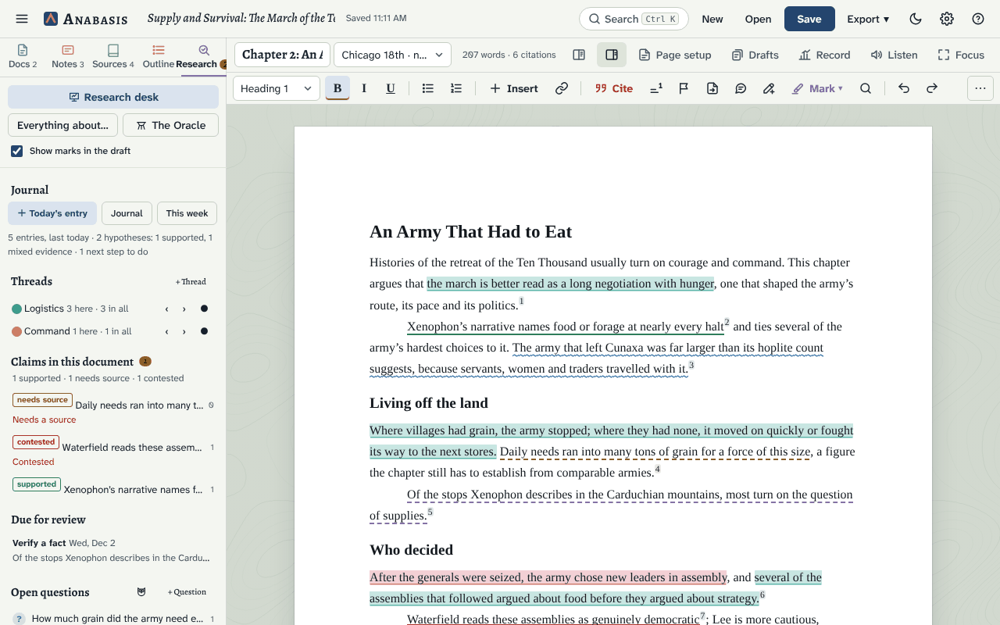

Anabasis is a word processor for research writing that runs as a single web page. It keeps your drafts, notes, sources and research records together in one project file, and it works offline. There's no account and no server. This wiki covers each part of it in more depth than the in-app Help has room for.

## Start here

- **[Getting started](Getting-Started)**: open the app, take the tour, start a project or open a finished example, and find your way around the screen.
- **[Projects, saving and privacy](Projects-and-Saving)**: what a project file holds, how saving and autosave work, locking, GitHub backup and the plain-file archive.

## Writing with sources

- **[Citations and styles](Citations-and-Styles)**: citing as you write, locators and note text, the 55 styles, and changing style at any time.
- **[Sources](Sources)**: adding sources by DOI, ISBN or web address, importing from Zotero and BibTeX, source types and ratings, the reading list, the source audit, retractions, duplicates, evidence fingerprints, searching inside sources, and My library across projects.
- **[Notes and the board](Notes-and-the-Board)**: quote, paraphrase, summary and idea notes, linking notes to each other, and sorting them on the board before you draft.
- **[Reading PDFs](Reading-PDFs)**: the PDF reader, quote and paraphrase notes with page numbers and highlights, and Take notes, which puts the PDF and a note pad side by side.
- **[Archive photos](Archive-Photos)**: photos from an archive visit, filed by box and folder, transcribed, and turned into notes that cite where each document came from.
- **[Languages and translation](Languages-and-Translation)**: writing in 27 languages, passages in another language, transliteration, special characters, translation notes, the glossary and the translation workspace.

## Thinking it through

- **[The research journal](Research-Journal)**: research design, hypotheses, the dated log, the search log, the twelve research-process prompts, and the research guide: stage guides, checklists, method guides and a glossary.
- **[Literature grid and codes](Literature-Grid-and-Codes)**: your sources against your questions and themes, and qualitative coding with a codebook.
- **[Socrates](Socrates)**: a deck of 364 questions to start from, and Examine a claim, a short walk through the Socratic method.
- **[The Oracle](The-Oracle)**: a conversation partner in the manner of ELIZA that answers from your own project. No AI; nothing goes online.

## Finishing

- **[Checking the draft](Checking-the-Draft)**: close to your notes, Proofread, house style, corroboration, acronyms, estimative language, accessibility, and flags left to resolve.
- **[Exporting](Exporting)**: Word, PDF, web page, e-book, Substack, Markdown, Pandoc and LaTeX, a page for reviewers and importing their review, plus the abstract and keywords, and pseudonyms.

## Where else to look

- **Help** inside the app (the **?** button) has a short section on every feature, and it's always the right version for the copy you have.
- The **[quick start](https://github.com/gmichaelrapp/anabasis/blob/main/docs/quick-start.md)** walks from a blank page to a PDF in about ten minutes.
- **[Privacy](https://github.com/gmichaelrapp/anabasis/blob/main/docs/privacy.md)** lists every time Anabasis connects to the internet, and why.
- **[File format](https://github.com/gmichaelrapp/anabasis/blob/main/docs/file-format.md)** documents the project file, for anyone who wants to read it with other tools.
- **[Releases](https://github.com/gmichaelrapp/anabasis/releases)** has every version, with checksums.

More pages are on the way: the editor and toolbar, figures, charts and maps, data and dashboards, threads and claims, planning, co-writing and suggestions, drafts and checkpoints, and keyboard shortcuts.

These pages are kept in the main repository under `docs/wiki/` and published here automatically, so a correction can come as an ordinary pull request.
