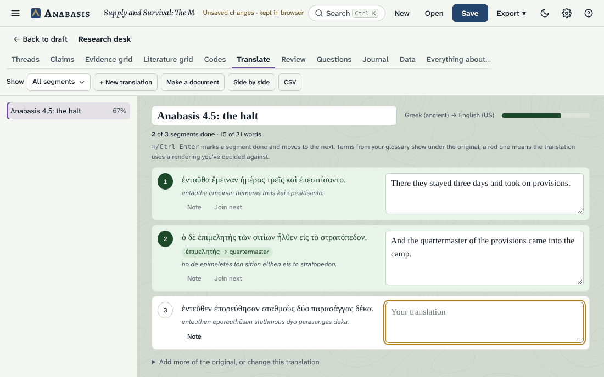

Anabasis writes in 27 languages, and it has the tools a translator needs: notes that keep the original beside your translation, a glossary that checks your renderings as you write, standard transliteration tables, a palette of special characters, and a workspace for translating a passage segment by segment.

## Writing in another language

**Page setup → Language** sets the language of a document. Everything that depends on language follows it:

- **Spell-checking** in the browser, and **Proofread**.
- **Quotation marks**: “English”, „Deutsch“, « français », «русский», 「日本語」. Smart quotes as you type and Proofread's quotation checks use the document's marks.
- **Citation terms**. Citations and the bibliography are formatted with the language's CSL locale, so an editor is "Hrsg." in German and a translator "trad." in French. The style doesn't change; its words do.
- **Direction**. Arabic, Hebrew, Persian and Urdu run right to left, in the page and in every export.
- **Word counts**. Chinese and Japanese count characters, as their publishers do.
- **Reading aloud** uses a voice for the language when your computer has one.
- **Exports**. Word files, web pages and e-books are marked with the language, so Word's own spell-checker and screen readers get it right.

### A passage in another language

Select a quotation or a name and choose **Mark → Language of this passage…**. The passage is spell-checked and read aloud in its own language, runs in its own direction, and keeps its language in Word, web and e-book exports. Choose *Same as the document* to clear it.

## Transliteration

Select text and choose **Mark → Transliterate…** (or *Transliterate* in the command search). Pick a system, check the result, and **Replace** the selection or copy it.

| Language | Systems |
|---|---|
| Russian | ALA-LC (Library of Congress), BGN/PCGN, or simple (no diacritics) |
| Ukrainian | National (2010), ALA-LC |
| Bulgarian | The official system (2009) |
| Serbian | Cyrillic to Serbian Latin |
| Greek, modern | ELOT 743 |
| Greek, ancient | ALA-LC, with rough breathings as *h* and long vowels marked |
| Arabic | ALA-LC, for the letters as written (short vowels that aren't written can't be guessed) |

Anabasis picks a system from the script it sees, or the one you've recorded in the research journal, and remembers the one you last chose.

## Special characters

**Special characters** (**⌘/Ctrl Alt O**, or *Special characters* in the command search) opens a palette that stays open while you work. Its tabs hold accented Latin letters, Greek (with a builder for breathings, accents and iota subscripts), Cyrillic, transliteration marks such as ā ḥ ṣ ʿ ʾ, punctuation and symbols. Click a character to insert it where you were typing, in the page or in any field. Capitals switches the case.

## Translation notes

A note of kind **Translation** has fields for:

- the **original**, and its language;
- its **transliteration**, if you want it;
- your **translation**, in the note's text;
- who translated it: **you**, or **another translator** by name.

When you insert a translation note, it goes in the way you've chosen in the research journal:

- your translation in the text, the original in the note (the default);
- your translation in the text, the original in brackets after it;
- the original in the text, your translation in the note;
- your translation alone.

The note adds "My translation." or "Trans. *Name*." for you, after the citation.

## The translation journal and glossary

**Research → Journal → Translation** records the decisions a translation rests on:

- the languages you translate from and into, and the transliteration system you follow;
- how translation notes are inserted, and whether to say "My translation.";
- a **glossary**: each term in the original, how you render it, renderings you've decided against, and a note on why.

The glossary is checked as you write. **Outline → Glossary** lists every place where a term appears in a rendering you've decided against, in reading order; click one to go there, or **Replace** it with your rendering. Matching ignores accents and breathings, so ἐπιμελητής is found as ἐπιμελητὴς too.

**Note on translation** writes a front-matter note from what you've recorded: the languages, whose translations they are, the transliteration system, and the glossary's main decisions. **Glossary** makes a document of the glossary; **CSV** saves it for a spreadsheet.

## The translation workspace

For anything longer than a quotation, use **Research desk → Translate**.

1. **New translation**: give it a title, choose the languages and the source it comes from, paste the original, and split it into **paragraphs** or **sentences**.
2. Each **segment** shows the original, its transliteration, and the glossary terms it contains with the rendering you decided on. Type your translation beside it.
3. **⌘/Ctrl Enter** marks a segment done and moves to the next. A segment you've started is a draft until you mark it done.
4. As you type, a glossary term turns **green** when your translation uses your rendering and **red** when it uses one you've decided against.

The side list shows each translation and how much is done. Above the segments you can filter to **what's left**, see the words and segments done, **Join next** to merge a segment with the one after it, or make a **Note** from a segment: a translation note with the original, its language and your translation, cited to the source.

When you're finished:

- **Make a document**: your translation as a new document, with untranslated segments highlighted in the original so nothing is missed.
- **Side by side**: a two-column table, the original (marked with its language) beside the translation.
- **CSV**: the segments, for a spreadsheet or another tool.

Translations are kept in the project file.

## Related pages

- [Notes and the board](Notes-and-the-Board)
- [Citations and styles](Citations-and-Styles)
- [The research journal](Research-Journal)
- [Sources](Sources)
