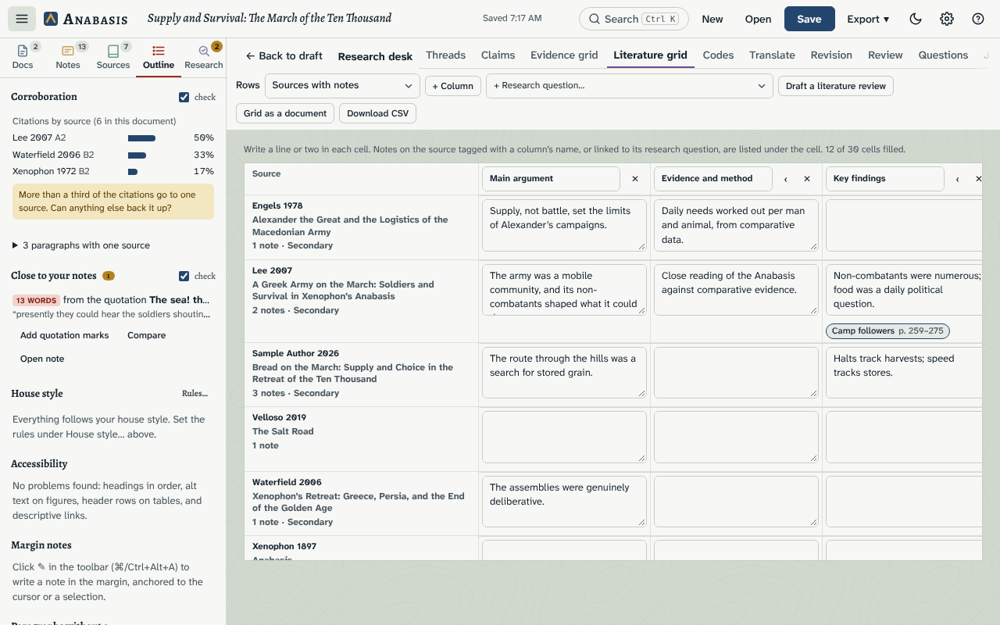
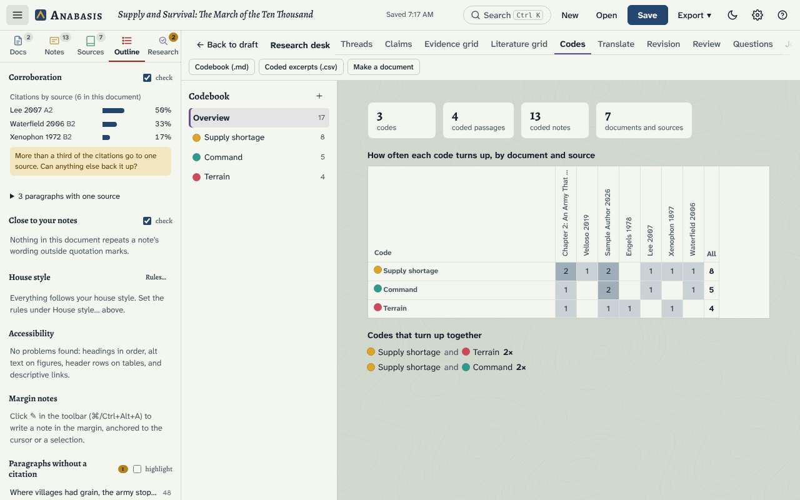

Two views on the research desk help you see what your material adds up to. The **literature grid** sets your sources against the questions and themes you're reading for, which is the table most literature reviews are drafted from. **Codes** are for qualitative coding: labelling passages in interviews, field notes and documents, and then gathering and counting them.

Both are on the research desk (**Research desk** in the Research tab), each with a tab of its own.

## The literature grid

Each row is a source; each column, something you're reading for. A new grid starts with five columns:

- **Main argument**: what the source claims.
- **Evidence and method**: what it rests on, and how it was done.
- **Key findings**: what it found that matters to you.
- **Limits and gaps**: what it can't show, or didn't look at.
- **How I'll use it**: where it goes in your own piece.

Rename any column by clicking its name, move it left with **‹**, or remove it with **✕**. **+ Column** adds one, and **+ Research question…** adds any of your open research questions as a column, so the grid can be organized around what you're trying to find out.

### Filling it in

Write a line or two in each cell. Short is better: the grid is for comparing across a row and down a column, and long cells make that hard.

Under each cell, the grid lists the notes that bear on it:

- for an ordinary column, notes on that source **tagged with the column's name** (tag a note `limits and gaps` and it shows in that column);
- for a research-question column, notes on that source **linked to the question** in the Plan.

Click a note to open it.

### Which sources

**Rows** chooses which sources appear: sources with notes (the default), sources cited anywhere in the project, or every source. A source with something written in its row always stays.

### Taking it further

- **Draft a literature review** turns the grid on its side into a first draft (see below).
- **Grid as a document** turns the grid into a table in a new document, with each source cited, so the bibliography builds itself.
- **Download CSV** opens in any spreadsheet.

The grid is kept in the project file.

### Drafting the review

A literature review is organized by theme, not by source: it compares what the sources say on each question, rather than summarizing them one after another. **Draft a literature review** reorganizes the grid that way. It makes a new document called *Literature Review* with:

- **an introduction**, with a prompt for the question the review answers and how you found and chose the sources;
- **a section for each column** (each theme or research question), holding every source's summary from that column as a sentence with its citation, followed by a prompt to compare them;
- under each section, the sources that have **notes on the theme but no summary** in the grid yet, and the sources **silent on it**, which is often where a gap in the literature, or in your reading, shows up;
- **Gaps and open questions** and **What this review sets up**, with prompts, and your *How I'll use it* notes gathered there rather than given a section of their own.

The citations follow the open document's style: a note reference after the full stop in a notes style, an author-date citation before it. The prompts are highlighted, so they're easy to find and delete as you rewrite. The summaries are where you start, not the finished paragraphs: rewrite each section into prose that says where the sources agree, where they differ and why.

You can also start it from **Templates** in the Docs tab or **Export → Other formats → Literature review draft**. For the shape of the argument before you draft, **Plan → Templates → Literature review** sets out an outline: the question and scope, themes with what the sources agree on and where they disagree, gaps, and what your review sets up.

## Codes

A **code** is a short label for an idea, theme or pattern, such as *supply shortage* or *distrust of officials*. Coding means reading through your material and attaching codes to passages, so you can gather every passage on a theme, see how often each turns up, and notice which appear together. It's the core of qualitative analysis of interviews, field notes and documents.

### Coding a passage in a document

1. Select the passage.
2. Choose **Mark → Code passage…**, or press **Ctrl+Alt+G** (**⌘⌥G**) and then **K**.
3. Pick a code, or name a new one, with a definition if you like.

Coded passages are underlined in the code's color. Click one to see its code, read every passage under it, or remove it. Codes are research marks like threads and claims, so they never appear in an export.

### Coding a note

Open a note and use **＋ Code…** under its title. Coding notes is the way to code material that lives in notes rather than documents: interview excerpts made with **Transcript…**, quotes from the PDF reader and quotes from [archive photos](Archive-Photos).

### The codebook

Each code has a name, a color and a **definition**: what the code means, when to use it, and when not to. Definitions keep your coding consistent across weeks of work, and let someone else check it. Write them early, and sharpen them when you find a passage you're not sure about.

### On the research desk

**Overview** shows:

- how many codes, coded passages and coded notes there are;
- a table of **how often each code turns up in each document and source**, shaded so the busiest cells stand out;
- **codes that turn up together**: pairs of codes on the same note or in the same paragraph, most frequent first. Pairs that keep turning up together are often worth a closer look.

Select a code to see its definition (edit it there) and **every passage and note under it**, each with where it came from. Click an excerpt to go to it.

### Exports

- **Codebook (.md)**: every code with its definition and how often it's used.
- **Coded excerpts (.csv)**: one row per coded passage or note, with its code, kind and source. Opens in a spreadsheet, or in other analysis tools.
- **Make a document**: a document of codes and their excerpts, with citations where the excerpts come from sources.

### Tips for coding

- **Start with a handful of codes from your question**, then add codes as the material suggests them. Go back and recode earlier material when you add one.
- **Code generously at first.** It's easier to merge two codes than to find passages you skipped.
- **Read the excerpts, not just the counts.** The counts say where to look; the passages say what it means.
- **Stop adding codes when new material stops suggesting new ones.** Researchers call this saturation.

The research guide in the journal has a fuller method guide on document and content analysis, and one on interviews. See [The research journal](Research-Journal).

## Related pages

- [The research journal](Research-Journal)
- [Notes and the board](Notes-and-the-Board)
- [Archive photos](Archive-Photos)
