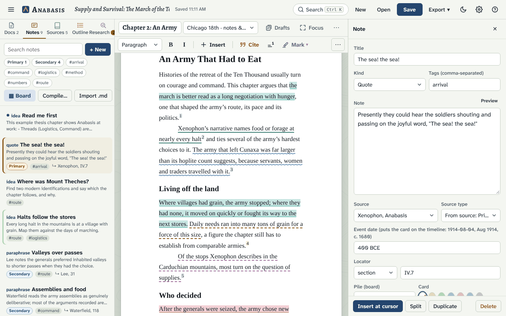
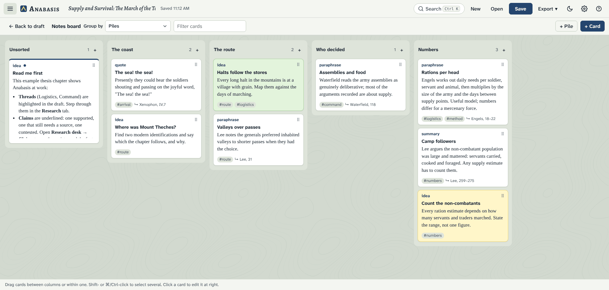

Notes are where research turns into writing. A note holds a quotation, a paraphrase, a summary or an idea, linked to its source and page. Notes can be tagged, linked to each other, sorted into piles on a board like index cards, and dropped into a draft with their citations. This page covers all of that.

## Making a note

Open the **Notes** tab and choose **+ New**. There are quicker ways too:

- **Capture as a note** (the note-with-arrow button, or **Ctrl+Shift+E**) turns selected text in the draft into a note. If the passage carries a citation, the note is linked to that source. With nothing selected, it opens a blank note for a quick idea.
- **+ Note on this** on a source starts a note already linked to it.
- **Quote note** and **Paraphrase note** in the PDF reader make a note from a selected passage, with the page filled in. See [Reading PDFs](Reading-PDFs).
- **Transcript…** on a source turns selected lines of an interview or video transcript into notes, with the timestamp as the locator.
- **The web clipper** sends a passage selected on any web page into the project as a quote note.
- **Freewrite** in the Plan saves a timed sprint as a note, linked to the plan item it was about.
- **The Oracle** files a note when you say `note: …` to it.

### What a note holds

- **Title**: a short handle, so you can find the note and link to it.
- **Kind**: **quote** (the source's exact words), **paraphrase** (its point in your words), **summary** (a longer passage boiled down) or **idea** (your own thinking).
- **Tags**: as many as you like, separated by commas: `chapter 3, logistics, Xenophon`.
- **Note**: the text itself, in Markdown. `**bold**`, `*italic*`, `- lists` and `> quotes` work. **Preview** shows it formatted.
- **Source** and **Locator**: which source it comes from, and where (a page, a timestamp, a section).
- **Source type**: primary, secondary or tertiary. A note takes its source's type unless you set its own.
- **Event date**: when the thing in the note *happened*, as opposed to when the source was published. Dates can be years, "Aug 1680", full dates, ranges such as "1680–1692", or BCE. Notes with an event date line up on the board's timeline.
- **Pile**: which pile it sits in on the board.
- **Card color** and **Pin**, for sorting by eye. Pinned notes stay at the top of the list.

### Links between notes

Write `[[Another note]]`, using the other note's title, to link to it. Links and backlinks show under each note, so you can follow an idea through the notes that touch it. Clicking a link to a note that doesn't exist yet offers to create it.

### Splitting and duplicating

**Split** breaks a note in two at the cursor, which is handy when one long note turns out to hold two ideas. **Duplicate** makes a copy to rework.

## Finding notes

The search box at the top of the Notes tab filters the list as you type. The chips under it filter by source type and tag. **Ctrl+K** searches notes along with everything else.

## From note to draft

Put the cursor where the note belongs in the draft, then either:

- choose **Insert at cursor** at the foot of the note, or
- drag the note from the Notes list onto the page and let go where it should go.

A **quote** comes in with its citation. Quotations of 100 words or more become block quotes; shorter ones get quotation marks. Other kinds of note come in as text, with the citation if they have a source.

### Quotes stay linked

A quotation inserted from a quote note stays linked to the note. If the wording in the draft drifts from the note, **Outline → Quotes** flags it. **Compare** shows the difference, and you can restore the original or update the note. Ellipses (…) and [bracketed changes] count as legitimate edits, so a properly trimmed quotation isn't flagged. Long quotations typed or pasted without a note are listed as *unlinked*, as a reminder to check them against the source.

## The board

**▦ Board** in the Notes tab lays your notes out as cards, for the stage when you're working out what goes where.

### Ways to group the cards

Choose a grouping from the menu at the top of the board:

- **Piles** you name yourself: chapters, arguments, "maybe", "cut".
- **Tags**, **Sources** or **Kind**: a column for each.
- **Free canvas**: no columns. Arrange the cards anywhere, like index cards on a table.
- **Timeline (by event date)**: the notes in the order things happened, with gaps in the record marked. **Insert as figure** turns the timeline into a graphic for the draft, and **Templates → Chronology** turns it into a document.

### Moving cards

Drag cards to reorder them, or to move them between columns. Moving a card changes its pile, tag, source or kind to match the column it lands in. Dragging works with a mouse, a trackpad or touch.

The board's order matters: it's the default order for **Compile notes** and for drafting from cards.

### Working with several cards

**Shift-click** or **Ctrl-click** (**⌘-click**) to select several cards, then:

- **color**, **pin** or **tag** them together;
- **move** them to another pile;
- **merge** them into one note;
- **delete** them;
- or **draft from these**, which makes a new document from the cards in order.

## Compiling notes into a draft

**Compile…** in the Notes tab turns a set of notes into a draft. Choose which notes (all, or one tag or source), then how to arrange them: in the order shown (board order by default, which you can change by dragging), grouped by tag, or grouped by source. Tick **Note titles as headings** and **Cite linked sources** as you need, and send the result to a new document or insert it at the cursor in the current one. It's a fast way to get from a pile of research to a rough first draft you can rewrite.

## Bringing notes in from elsewhere

**Import .md** in the Notes tab reads Markdown files: a few files, or a whole folder such as a Notecards folder or an Obsidian vault.

- The first `#` heading becomes the note's title.
- `tags:` in the front matter, or `#hashtags` in the text, become tags.
- Subfolders can become piles on the board.

**Export → All notes as Markdown** writes them all to one Markdown file, and the plain-file archive (Export menu) saves each note as its own file.

## The notes inbox

**Project home** lists notes not yet linked to the plan or sorted into a pile, so new research doesn't get lost. Sort them into piles on the board, or drag them onto a plan item to link them.

## Tips

- **One idea per note.** Small notes are easier to sort, link and move. Use **Split** when a note grows two ideas.
- **Always fill in the locator.** A quote note without a page number means a trip back to the library later.
- **Use the idea kind for your own thinking.** It keeps your words apart from your sources' when you compile.
- **Name piles after what you'll write**, such as chapters or sections, so the board becomes your outline.

## Related pages

- [Sources](Sources)
- [Reading PDFs](Reading-PDFs)
- [The research journal](Research-Journal)
