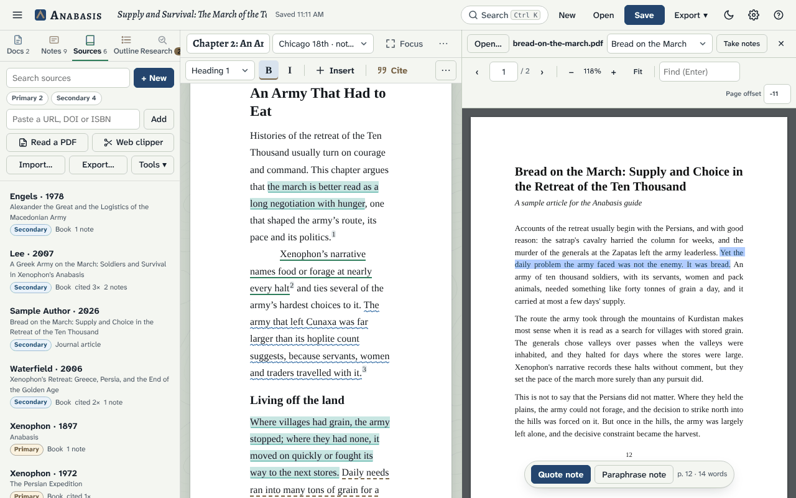

Anabasis has a PDF reader built in, so you can read an article or a scanned book beside your draft and turn passages into notes without retyping them or losing the page number. **Take notes** goes a step further: it sets the draft aside and puts the PDF and a note pad side by side, for a reading session.

The reader uses PDF.js, Mozilla's PDF engine, inside the page. Nothing is uploaded anywhere.

## Opening a PDF

Any of these opens the reader beside your draft:

- **Read a PDF** in the Sources tab;
- dropping a PDF file anywhere on the Anabasis window;
- **Attach PDF** on a source (or **Read PDF**, once one is attached);
- **Read a PDF beside the draft** in the command search (**Ctrl+K**).

Drag the reader's left edge to make it wider or narrower.

### Getting around

- **‹ ›** turn the page, or type a page number.
- **− +** zoom, and **Fit** fits the page to the reader's width.
- **Find** searches the PDF's text. Press Enter for the next match.

A scanned PDF with no text layer can be read, but you can't select or search its text. Run it through OCR first (many scanners and Adobe Acrobat can) if you want to quote from it.

## Linking the PDF to a source

Use the menu at the top of the reader to link the PDF to one of your sources, or choose **New source from this PDF**. A new source uses the PDF's DOI when it has one, which fills in the details from doi.org; otherwise it uses the title, author and date stored in the PDF. Check what comes back.

A linked PDF is kept in this browser, so it reopens from its source with **Read PDF**. PDFs are never put in your project file, which keeps the file small. That means:

- on another computer or browser, attach the PDF to the source again;
- **Start fresh → Erase everything** removes stored PDFs;
- a locked project doesn't lock its PDFs.

Keep your PDFs in a folder of their own, alongside your project file.

## Notes from the reader

Select a passage in the PDF, then choose:

- **Quote note** to save the passage word for word, with its page number filled in;
- **Paraphrase note** to save it and open the note straight away, so you can rewrite it in your own words.

The note is linked to the PDF's source, so it carries its citation into the draft. See [Notes and the board](Notes-and-the-Board).

### Highlights stay in the PDF

A quote or paraphrase note made from the reader leaves a **highlight** where the passage is on the page: yellow for quotes, blue for paraphrases and summaries. A small marker in the right margin opens the note (in Take notes, it finds the note in the list beside the pad).

The highlights are kept with the notes, in the project file, so they come back whenever you open the PDF again, on this computer or another. Delete the note and its highlight goes with it.

### Page offset: when the PDF's page numbers aren't the printed ones

A PDF's own page count often differs from the numbers printed on the pages. A book's first page of text may be the PDF's page 15, after the cover and front matter. Set **Page offset** to the difference (here, 14) and quote notes get the printed page number, which is the one your citation needs.

Many PDFs carry built-in page labels (i, ii, iii… then 1, 2, 3…). Anabasis reads those automatically, and you don't need an offset.

## Take notes: the PDF and a note pad side by side

**Take notes** in the reader's top bar is for a sitting of reading. It sets the writing aside: the PDF fills the left of the screen and a note pad opens on the right.

### Writing in the pad

1. Choose the kind of note: **Idea**, **Quote**, **Paraphrase** or **Summary**.
2. Write it. To quote, select a passage in the PDF and click **Quote note**: the passage goes into the pad, and you add your comment under it.
3. Check the page. **p.** follows the PDF as you scroll, so it's usually right already. Type a number to change it.
4. Add tags if you like. They stay for the next note, so a run of notes on one chapter keeps its tag.
5. Press **Ctrl+Enter** (**⌘Enter**) or choose **Save note**.

Each note goes to the PDF's source, with the page filled in, so it's ready to cite.

### The notes so far

Under the pad, **Notes** lists every note on this PDF's source, in page order. Click a note's text to edit it where it is, or click its page to jump there in the PDF. It's an easy way to see what you've already taken from a source before you start on a new chapter of it. If the PDF isn't linked to a source yet, saving the first note links it to a new one.

### Back to writing

**Back to writing** closes the pad and returns to your draft, with the PDF still open beside it.

## Scanned PDFs: Read text

Some PDFs are pictures of pages, scanned or photographed, with no text in them: you can't select a passage, and [Search inside sources](Sources#search-inside-sources) lists them as scanned. **Read text** in the reader's top bar reads every page **on this computer**, with Tesseract, and nothing is sent anywhere. It takes a few seconds a page; a window shows its progress and the text as it goes, and you can stop it at any time.

When it's done, the PDF's text can be searched, and you can **Copy** the text or **Quote note** from it. Printed and typed pages read well; check what it read against the page before you quote it, and expect handwriting and poor scans to come out badly. It reads English.

## PDFs with no notes yet

**Loose ends** on Project home lists sources with a PDF attached and no notes yet, so a PDF you meant to read doesn't sit forgotten.

## In the research journal

The journal's **Notes on a source** prompt asks what a source says, how it helps answer your question, and how far you trust it. It's a good companion to a reading session: take notes in the pad, then write a short journal entry on the source as a whole. See [The research journal](Research-Journal).

## Tips

- **Link the PDF to its source before you start.** Every note you take is then linked and cited.
- **Set the page offset first** if the printed numbers differ, before you make any notes.
- **Prefer Paraphrase note for long passages.** You'll use your own words in the draft anyway, and doing it while the source is in front of you is easier.
- **Quote short, comment long.** In the pad, quote the sentence that matters and write a few lines on why. The comment is what you'll be glad of later.

## Related pages

- [Notes and the board](Notes-and-the-Board)
- [Sources](Sources)
- [The research journal](Research-Journal)
