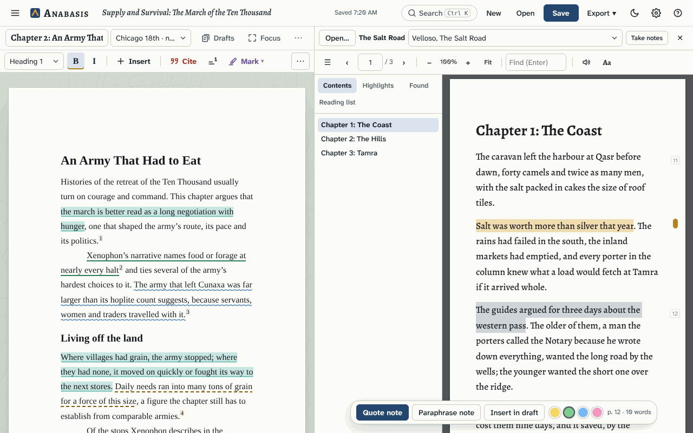
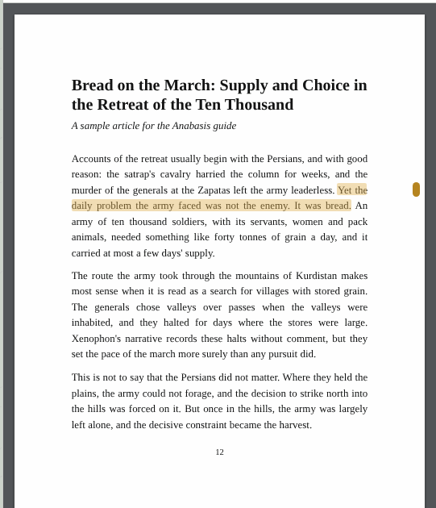
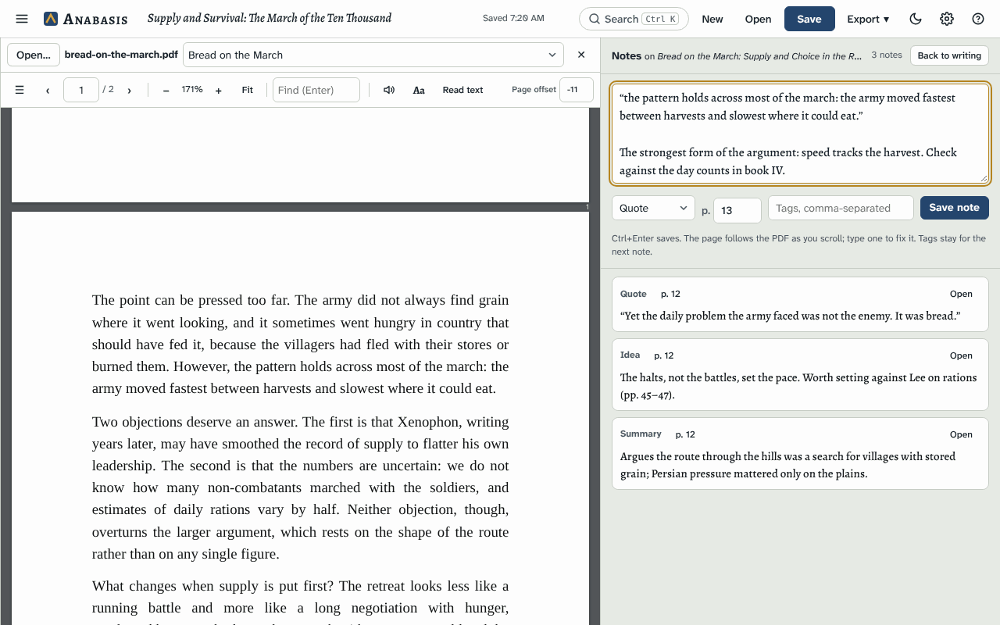

Anabasis has a reader built in, for PDFs and ePubs, so you can read an article, a scanned book or an ebook beside your draft and turn passages into notes without retyping them or losing the page number. **Take notes** goes a step further: it sets the draft aside and puts the PDF or book and a note pad side by side, for a reading session.

The reader uses PDF.js, Mozilla’s PDF engine, inside the page, and reads ePubs itself. Nothing is uploaded anywhere.

## Opening a PDF or an ePub

Any of these opens the reader beside your draft:

- **Read PDF / ePub** in the Sources tab;
- dropping a PDF or ePub file anywhere on the Anabasis window;
- **Attach PDF** on a source (or **Read PDF**, once one is attached);
- **Read a PDF or ePub beside the draft** in the command search (**Ctrl+K**).

Opened with nothing in it, the reader lists what you were reading, so you can pick up where you left off.

Drag the reader’s left edge to make it wider or narrower.

### Getting around

- **‹ ›** turn the page, or type a page number.
- **− +** zoom, and **Fit** fits the page to the reader’s width.
- **Find** searches the text. Press Enter: every match is listed under **Found** in the side panel, with its page and the words around it, and the reader goes to the first one after where you are. Enter goes to the next, Shift+Enter back, Esc clears.
- **☰** opens the side panel (see below).
- **Aa** sets the view, and the speaker reads aloud.

A scanned PDF with no text layer can be read, but you can’t select or search its text. Run it through OCR first (many scanners and Adobe Acrobat can) if you want to quote from it.

## ePubs

An ePub is the usual ebook file. Anabasis opens **DRM-free** ePubs: books from Project Gutenberg and Standard Ebooks, and from publishers that sell without DRM. A book locked to a store’s app can’t be opened; the reader says so.

Each chapter of the book is a sheet in the reader, and **− +** make the type larger or smaller. The book’s own styles are set aside for a plain, readable page, keeping its italics, headings, lists, tables and pictures. Nothing in the book runs: scripts, forms and anything from the web are left out, and its links to other places in the book take you there.

### Pages, chapters and paragraphs

A quotation needs a place. Many ePubs made from printed books mark where each printed page begins; Anabasis reads those marks, shows them as small numbers in the margin of the text, and gives a quote the printed page, as for a PDF.

When a book doesn’t mark its pages, a quote gets its **chapter and paragraph** instead: *ch. 3, para. 12*. A section with no number, such as an introduction, is cited by its title: *sec. Introduction, para. 4*. That’s what Chicago and MLA ask for with an ebook that has no fixed pages. You can change the place in the note.

A new source from an ePub uses the book’s own title, author, publisher, date, language and ISBN, and if a source with the same ISBN or title is already in the project, the book is linked to it.

## The side panel

**☰** opens a panel beside the page:

- **Contents**: the PDF’s or the book’s own table of contents, with where you are marked. Click to go there.
- **Pages**: a thumbnail of every page of a PDF.
- **Highlights**: your highlights on this source (see below).
- **Found**: every match for **Find**.
- **Reading list**: see below.

On a narrow screen the panel opens over the page and closes when you choose something.

## Where you left off, and the reading list

Close a PDF or a book and open it again, from its source or by dropping the file, and it opens where you stopped. The place is kept in this browser, beside the file, not in the project.

The **Reading list** tab shows the sources you’re **Reading**, those **To read** (★ first) and every other PDF or ePub kept in this browser, with how far you’ve got and when you last read it. Change a source’s status there, or click it to open it where you left off. Opening a source marked *To read* moves it to *Reading*; reach the end and Anabasis offers **Mark as read**.

## The view: paper, sepia, night; one page or two

**Aa** sets how the reader looks:

- **Paper**, **Sepia** or **Night**. Night turns a PDF’s white pages dark and its black text light, which is easier late in the evening. Highlights stay visible.
- **One page** or **Two pages** side by side, for a PDF, with the first page alone as in a printed book. Two pages are easiest to read in **Take notes**, or with the reader made wide.
- **Book** or **Plain** type, for an ePub.

## Linking the PDF to a source

Use the menu at the top of the reader to link the PDF to one of your sources, or choose **New source from this PDF**. A new source uses the PDF’s DOI when it has one, which fills in the details from doi.org; otherwise it uses the title, author and date stored in the PDF. Check what comes back.

A linked PDF is kept in this browser, so it reopens from its source with **Read PDF**. PDFs are never put in your project file, which keeps the file small. That means:

- on another computer or browser, attach the PDF to the source again;
- **Start fresh → Erase everything** removes stored PDFs;
- a locked project doesn’t lock its PDFs.

Keep your PDFs in a folder of their own, alongside your project file.

## Notes from the reader

Select a passage in the PDF, then choose:

- **Quote note** to save the passage word for word, with its page number filled in;
- **Paraphrase note** to save it and open the note straight away, so you can rewrite it in your own words.

The note is linked to the PDF’s source, so it carries its citation into the draft. See [Notes and the board](Notes-and-the-Board).

### Quote straight into the draft

**Insert in draft** in the same bar quotes the passage at the cursor in your draft, with its citation and page, and keeps it as a quote note too. A short quotation runs into your sentence, in quotation marks; a long one, or one where the cursor is on an empty line, becomes a block quotation. Click in the draft where the quotation should go before you select it in the reader.

### Highlights stay in the PDF

A quote or paraphrase note made from the reader leaves a **highlight** where the passage is on the page: yellow for quotes, blue for paraphrases and summaries. A small marker in the right margin opens the note (in Take notes, it finds the note in the list beside the pad).

The highlights are kept with the notes, in the project file, so they come back whenever you open the PDF again, on this computer or another. Delete the note and its highlight goes with it.

### Highlights without notes

Not every passage needs a note. Select it and click one of the four colors in the bar (yellow, green, blue and pink) to highlight it, nothing more. Use the colors however suits you: one for evidence, one for passages to check, one for good writing.

Click a highlight to change its color, **Make a note** of it (it becomes a quote note with its page), **Insert in draft**, or **Remove** it.

The **Highlights** tab of the side panel lists them in the order they come in the PDF or book, all or one color at a time. From there:

- **Copy as text**, each highlight in quotation marks with its page;
- **Download (.md)**, a Markdown file with the source and every highlight as a quotation;
- **Make notes of these**, which turns the highlights listed into quote notes at once.

Highlights are kept with their source in the project file, so they come back on any computer.

### Page offset: when the PDF’s page numbers aren’t the printed ones

A PDF’s own page count often differs from the numbers printed on the pages. A book’s first page of text may be the PDF’s page 15, after the cover and front matter. Set **Page offset** to the difference (here, 14) and quote notes get the printed page number, which is the one your citation needs.

Many PDFs carry built-in page labels (i, ii, iii… then 1, 2, 3…). Anabasis reads those automatically, and you don’t need an offset.

## Take notes: the PDF and a note pad side by side

**Take notes** in the reader’s top bar is for a sitting of reading. It sets the writing aside: the PDF fills the left of the screen and a note pad opens on the right.

### Writing in the pad

1. Choose the kind of note: **Idea**, **Quote**, **Paraphrase** or **Summary**.
2. Write it. To quote, select a passage in the PDF and click **Quote note**: the passage goes into the pad, and you add your comment under it.
3. Check the page. **p.** follows the PDF as you scroll, so it’s usually right already. Type a number to change it.
4. Add tags if you like. They stay for the next note, so a run of notes on one chapter keeps its tag.
5. Press **Ctrl+Enter** (**⌘Enter**) or choose **Save note**.

Each note goes to the PDF’s source, with the page filled in, so it’s ready to cite.

### The notes so far

Under the pad, **Notes** lists every note on this PDF’s source, in page order. Click a note’s text to edit it where it is, or click its page to jump there in the PDF. It’s an easy way to see what you’ve already taken from a source before you start on a new chapter of it. If the PDF isn’t linked to a source yet, saving the first note links it to a new one.

### Back to writing

**Back to writing** closes the pad and returns to your draft, with the PDF still open beside it.

## Read aloud

The speaker in the reader’s top bar reads aloud from the top of what you can see, or from a passage you’ve selected, a sentence at a time, shading each sentence as it goes. It carries on to the next page or chapter. **Pause**, **‹ ›** (a sentence back or on), the speed, and **Stop** are in a bar at the bottom of the reader. It uses the voice and speed you chose for **Listen** in the draft, or a voice for the book’s language.

A scanned PDF has no text to read until you’ve used **Read text** on it.

## Scanned PDFs: Read text

Some PDFs are pictures of pages, scanned or photographed, with no text in them: you can’t select a passage, and [Search inside sources](Sources#search-inside-sources) lists them as scanned. **Read text** in the reader’s top bar reads every page **on this computer**, with Tesseract, and nothing is sent anywhere. It takes a few seconds a page; a window shows its progress and the text as it goes, and you can stop it at any time.

When it’s done, the PDF’s text can be searched, and you can **Copy** the text or **Quote note** from it. Printed and typed pages read well; check what it read against the page before you quote it, and expect handwriting and poor scans to come out badly. It reads English.

## PDFs with no notes yet

**Loose ends** on Project home lists sources with a PDF attached and no notes yet, so a PDF you meant to read doesn’t sit forgotten.

## In the research journal

The journal’s **Notes on a source** prompt asks what a source says, how it helps answer your question, and how far you trust it. It’s a good companion to a reading session: take notes in the pad, then write a short journal entry on the source as a whole. See [The research journal](Research-Journal).

## Tips

- **Link the PDF to its source before you start.** Every note you take is then linked and cited.
- **Set the page offset first** if the printed numbers differ, before you make any notes.
- **Highlight as you read, make notes after.** A first reading with highlights, then **Make notes of these** on the color that matters, keeps the reading moving.
- **Prefer Paraphrase note for long passages.** You’ll use your own words in the draft anyway, and doing it while the source is in front of you is easier.
- **Quote short, comment long.** In the pad, quote the sentence that matters and write a few lines on why. The comment is what you’ll be glad of later.

## Related pages

- [Notes and the board](Notes-and-the-Board)
- [Sources](Sources)
- [The research journal](Research-Journal)
