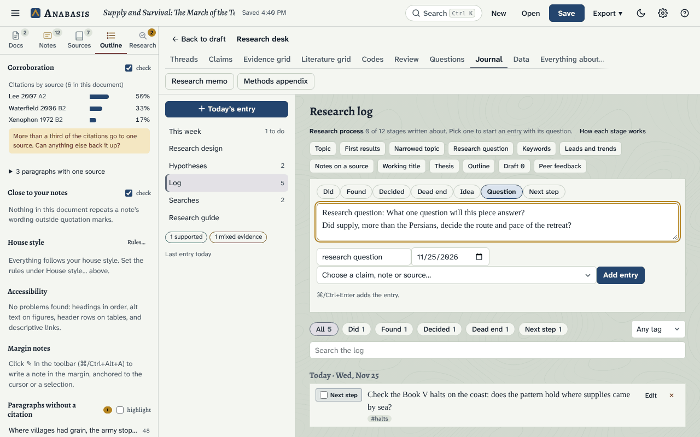
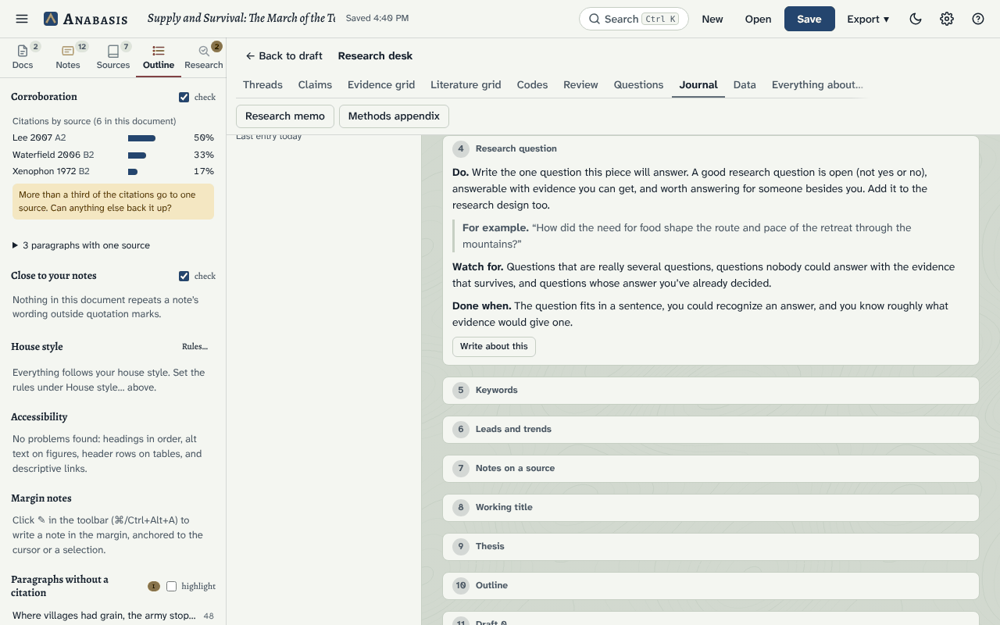

The research journal is where you keep the story of the research itself: what you set out to find, what you thought might be true, what you did each day, where you looked, and what changed your mind. It turns into a memo for a supervisor or editor, a methods appendix, or a weekly summary, whenever you need one.

Open it with **Journal** on the research desk, or **＋ Today's entry** in the Research tab.

The journal has four parts: the **research design**, **hypotheses**, the **log** and the **search log**. Beside them is the **research guide**, with stage guides, checklists, method guides and a glossary.

## The research design

The design is the plan for the research, written down so you can hold yourself to it (and change it on purpose rather than by drift). It has these sections:

- **Purpose and significance**: what you're trying to find out, and why it matters to your readers or your field.
- **Research questions**: the same questions as in the Plan and the Research tab, so a question added in one place shows in all three. Tick a question when it's answered.
- **Approach and methods**: how you'll answer the questions.
- **Sources and data**: what evidence you'll use, where it lives, and how you'll get access to it.
- **Scope and limitations**: what's in and out (dates, places, kinds of source), and what your evidence can't tell you.
- **Ethics and sensitivity**: consent, anonymity, safety, legal review, and how you handle personal data.
- **Milestones**: what's due when, if you want to set it out.

### Start from a method

**Start from a method**, at the top of the design, fills the methods, sources, scope and ethics sections with prompts for a kind of research: archival research, interviews, open-source investigation, document analysis, case studies, data analysis, a literature review or investigative reporting. Replace the [brackets] with your own plans. For mixed methods, add a second method: Anabasis asks whether to add its prompts below what's already there.

## Hypotheses

A hypothesis is a claim you could be wrong about. Writing one down makes it easier to notice when the evidence turns against it.

Each hypothesis has:

- a **status**: untested, supported, mixed evidence, weakened or refuted;
- the **research question** it answers;
- the **claims**, **notes** and **sources** that support it or challenge it.

Changing a hypothesis's status asks what changed. Your answer is dated in the hypothesis's history and recorded in the log, so later you can see when and why you changed your mind.

## The log

The log is a dated record of the research. Each entry has a **kind**:

- **Did**: what you did today.
- **Found**: something you found.
- **Decided**: a decision, and why.
- **Dead end**: somewhere that didn't pay off, so you don't try it again in six months.
- **Idea**: something to think about.
- **Question**: a new question.
- **Next step**: a to-do. Tick it when it's done. Open next steps show in This week, the Research tab and the research memo.

Give an entry tags, and link it to a claim, note, source or question if it's about one. **Ctrl+Enter** (**⌘Enter**) adds the entry. Filter the log by kind or tag, or search it.

Some entries are written for you, marked *Recorded*: a hypothesis's change of status, a question answered or reopened, or prompts added from a method. Saving a conversation with [the Oracle](The-Oracle) or an examined claim from [Socrates](Socrates) adds an entry too.

## The research-process prompts

Above the log, **Research process** offers a prompt for each stage of a research project, from a first topic to peer feedback on a draft. Pick a stage and its question goes into a new entry, with the kind of entry set and the stage added as a tag. A tick marks each stage you've written about, and the count shows how far through the process you are.

| Stage | Kind | The prompt asks |
|---|---|---|
| Topic | Idea | What do you want to find out about, and why does it matter to you? |
| First results | Found | What did a first search turn up? What surprised you, and what keeps coming up? |
| Narrowed topic | Decided | Which part of the topic will you write about, and what will you leave out? |
| Research question | Question | What one question will this piece answer? |
| Keywords | Did | Which words and phrases did you search with? Which worked, and which didn't? |
| Leads and trends | Idea | Which threads are worth following? What patterns are you starting to see? |
| Notes on a source | Found | What does the source say? How does it help answer your question, and how far do you trust it? |
| Working title | Decided | Does it hook a reader, and does it tell them what the piece is about? |
| Thesis | Decided | Your answer to the research question, in one or two sentences. |
| Outline | Idea | The introduction (hook, context, thesis), three or four main points with their evidence, and a conclusion: so what, and who cares? |
| Draft 0 | Did | What did you get down in a skeleton draft? What tone and approach are you finding? What will you do differently next time? |
| Peer feedback | Found | Who read it, what they said, and what you'll change and keep. |

**Notes on a source** asks which source first. Pick one and its citation goes into the entry, in the open document's style, with the entry linked to the source.

### Walking through a project with the prompts

The prompts follow the order most research goes in, and they work well as a checklist for a student paper or a first long piece:

1. **Topic.** Before searching, write down what you're curious about and why. It's the entry you'll come back to when the project loses its shape.
2. **First results.** After an hour or two of searching, note what came up again and again, and what surprised you. Log the searches themselves in the **search log** (below).
3. **Narrowed topic** and **Research question.** Cut the topic down to a question one piece can answer. Add it as a research question in the design, too.
4. **Keywords.** Record the search terms that worked and the ones that didn't. This saves real time later.
5. **Leads and trends.** As patterns emerge, write them down before they feel obvious.
6. **Notes on a source.** For each important source, an entry on what it says, how it helps, and how far you trust it. Pair this with notes taken in the [PDF reader](Reading-PDFs).
7. **Working title** and **Thesis.** Once you can answer the question, write the answer in a sentence or two, and a title that promises it.
8. **Outline.** The prompt gives a three-part skeleton to fill in. For something longer, use the Plan in the Docs tab.
9. **Draft 0.** After a first rough draft, note what you found out by writing it.
10. **Peer feedback.** Record who read it, what they said, and what you'll do about it.

The stages aren't a rule: skip some, go back to others, write about a stage more than once.

## The research guide

**Research guide**, the last section of the journal, is for anyone finding their way through a project for the first time, and for anyone who'd rather not skip a step. It has four parts.

- **Stages.** For each of the twelve research-process stages: what to do, a short example, what to watch for, and how to tell when it's done. **Write about this** starts a log entry with the stage's prompt. **How each stage works**, above the log, opens it.
- **Checklists.** Lists to work through at the right moment: *verifying sources*, *quotes, numbers and names*, *ethics, consent and safety*, *data, files and backups*, *before you submit*, and *open-source verification*. Ticks are saved with the project, and the journal shows how many items are left on the lists you've started.
- **Methods.** A short, practical guide to each of the eight methods in **Start from a method**: archival research, interviews, open-source investigation, document and content analysis, case studies, data analysis, literature reviews and investigative reporting. Each covers what to do before, during and after, what to watch for, and where Anabasis helps. **Add this method's prompts to the research design** fills in the design.
- **Glossary.** About sixty research terms in plain words, from *abstract* to *Wayback Machine*, with cross-references. Search it from the box at the top.

The guide is built into Anabasis and works offline.

## The search log

The search log records where you looked, the terms and filters you used, and how many results you got and kept, so the research can be repeated and reported. It downloads as CSV, for a methods section or a systematic review.

## What the journal makes

These are ordinary documents in your project. Make them again whenever you want them up to date.

- **Research memo**: the design, the hypotheses with their evidence, the searches, open next steps, and the last 30 days of the log, ready to send to a supervisor or editor.
- **Methods appendix**: back matter from the methods, sources, searches, scope and ethics.
- **Week summary**: from **This week** (below).

## This week

**This week** shows what moved since Monday: words written, log entries, searches, sources and notes added, claims checked, hypothesis changes and questions answered, plus review keys coming due. Step back to earlier weeks with **‹**. **Week summary** makes a document of it to send or keep.

## Finding things in the journal

**Everything about…** on the research desk searches the journal too, along with your documents, notes, sources and marked passages. Deleting a hypothesis, an entry or a search can be undone.

## Tips

- **Write a line every day you work on the project**, even if it's only "read two chapters of Lee; nothing for chapter 3". A month later, the log is the only record of what you've already ruled out.
- **Log dead ends.** They're the entries you'll be most glad of.
- **Use Decided entries for choices you might be asked to defend**, such as leaving out a source or narrowing the dates.
- **Make the research memo before every meeting** with a supervisor or editor. It takes a second and shows exactly where things stand.

## Related pages

- [Socrates](Socrates)
- [The Oracle](The-Oracle)
- [Reading PDFs](Reading-PDFs)
