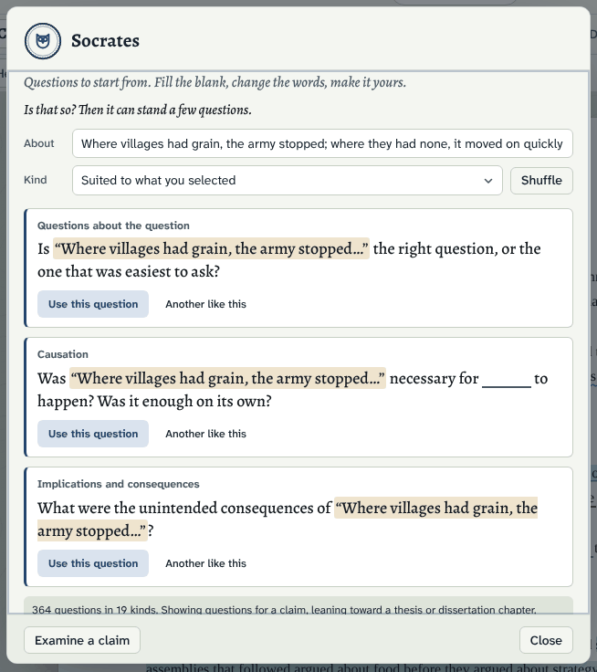
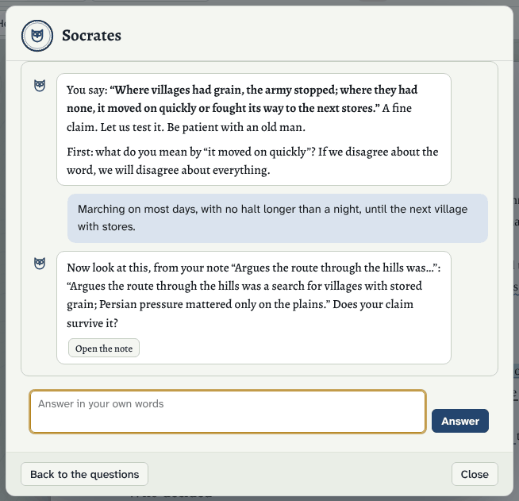

Socrates is for the moments when you know something's wrong with a passage but can't say what, or when you don't know what to ask next. It deals you good questions to start from, three at a time, fitted to what you've selected. **Examine a claim** goes further: a short walk through the Socratic method, testing one claim against your own notes until it says what you can defend.

Socrates isn't AI. It's a deck of 364 question stems, written for researchers working alone, built into Anabasis. It reads only what you've selected, and nothing leaves your computer.

## Opening Socrates

- **The owl** beside **+ Question** in the Research tab.
- **Mark → Ask Socrates…** in the toolbar, or **S** after **Ctrl+Alt+G**, with a passage selected.
- **Questions to start from** (the owl) at the foot of the new-question window.
- **Examine a claim** from the Oracle: say `examine:` followed by the claim. See [The Oracle](The-Oracle).

## The deck

### What you've selected shapes the questions

Select a word, a claim, a name, a number or a source before you open Socrates, and the questions are about it, with it filled into each one. Or type something into **About**. Leave it empty for questions about the piece as a whole.

Socrates works out what kind of thing you selected and deals questions that suit it:

- **a term**, such as *logistics* or *hoplite*: questions about meaning and definition;
- **a claim**, a sentence that asserts something: questions about evidence, assumptions and alternatives;
- **a person or group**: questions about motive, perspective and what we really know of them;
- **a place or event**: questions about causes, chronology and what might have happened otherwise;
- **a number**: questions about where it came from, what it measures and what it's compared with;
- **a source**: questions about provenance, purpose and reliability.

Some questions name parts of your own project when it has them: one of your sources' authors (one who writes about the selection, if any does), the chapter you're in, or a thread the passage belongs to. "Would Waterfield use the word *mercenary* the way I do?" is more use than a question about "your sources".

### Nineteen kinds of question

Choose a **Kind** to draw from just one, or leave it on any:

1. Clarifying meaning and terms
2. Evidence and how we know
3. Assumptions
4. Alternatives and competing explanations
5. Implications and consequences
6. Perspectives, actors and stakeholders
7. Sources and provenance
8. Causation
9. Time, chronology and change
10. Numbers, data and measurement
11. Comparison, analogy and context
12. Counterfactuals and contingency
13. Intelligence analysis: hypotheses, indicators, deception, confidence
14. Journalism and investigation: money, power, people
15. Argument and the shape of the piece
16. The reader
17. Yourself: bias, motive and blind spots
18. Questions about the question
19. When you are stuck

The kind of writing you're doing leans the choice: an intelligence brief draws more on intelligence-analysis questions, literary journalism on journalism and perspectives, a thesis on causation and sources. So do the kinds you use. Socrates keeps a count of which kinds you pick, in this browser's settings, and deals those a little more often. It keeps nothing about what you selected or asked.

### Working with the cards

- **Shuffle** deals three more.
- **Another like this** swaps one card for another of the same kind.
- **Use this question** makes it an open research question, linked to the passage you selected, ready to edit into your own words. It then shows in the Research tab, in the Plan and in the journal's research design. Some questions have a second blank (`___`) for you to fill.

The questions are a place to start, not a quiz. Rewrite them freely. A question you've turned into your own words is the one you'll actually answer.

## Examine a claim

**Examine a claim** walks you through the Socratic method in five short steps. It's for a claim you're about to build on, and want to be sure of first.

Start it from **Examine a claim** at the foot of the Socrates window. If you've selected a claim (or typed one into **About**), it begins with that; otherwise Socrates asks for one.

1. **What do you mean?** Socrates picks out the claim's key phrase and asks what you mean by it. "The march was decided by *supply*": supply of what, to whom, and how would you know it was lacking? Answer in a sentence or two.
2. **What pushes against it?** Socrates searches your own notes and paragraphs for a passage close to the claim that turns against it: a "but", a "however", a "fewer than". It quotes the sentence and asks how your claim survives it, with a button to open the note or go to the paragraph. If nothing in the project pushes back, it says so and asks you to name the strongest objection yourself.
3. **Mend the claim.** If the claim needs it, write the better version: narrower, hedged, or with its condition stated. Say "same" if it stands as it was.
4. **One last question.** Socrates asks one more question about the mended claim, about its evidence, implications, alternatives or assumptions.
5. **Before and after.** The summary sets out the claim as it was, what you mean by its key phrase, the passage it was tested against, and the claim as it is now.

From the summary:

- **Save to the journal** adds the whole exchange to today's log, tagged *socrates* and linked to the note it was tested against. See [The research journal](Research-Journal).
- **Copy the claim** copies the mended claim, to paste into the draft.
- **Examine another** starts again.
- **Back to the questions** returns to the deck.

Press **Enter** to answer; **Shift+Enter** starts a new line.

### Why it works

The steps are the old ones: define the terms, find the counterexample, revise. What makes them useful in Anabasis is step two. The counterexample comes from your own research, so it's the objection a reader who knows your sources would raise. Claims usually survive the exercise, but they come out narrower and better defended, and the journal keeps a record of why you worded them the way you did.

## How Socrates chooses

There's no model behind Socrates, only a list and some care in dealing from it:

- Each stem is tagged with the kinds of selection it suits. Questions meant for a person aren't dealt for a number, and claim questions need a claim.
- A stem that names part of your project (an author, a chapter, a thread) is used only when the project has one.
- Long claims are shortened, so the question stays readable.
- A question isn't dealt again until you've seen the rest of its kind.
- About one deal in three includes a question that names part of your project, when there's one to ask.

The stems are in `data/socrates.txt` in the source code, in a simple format documented at the top of the file, if you want to see them all or suggest more.

## Tips

- **Select less, not more.** A single term or one sentence gets sharper questions than a paragraph.
- **Use "Yourself" and "When you are stuck"** when the trouble isn't the evidence but the writing.
- **Examine the thesis.** Run your thesis through Examine a claim before you build a draft on it, and again after.
- **Keep the questions you use.** A question made with **Use this question** stays linked to the passage until you mark it answered.

## Related pages

- [The Oracle](The-Oracle)
- [The research journal](Research-Journal)
