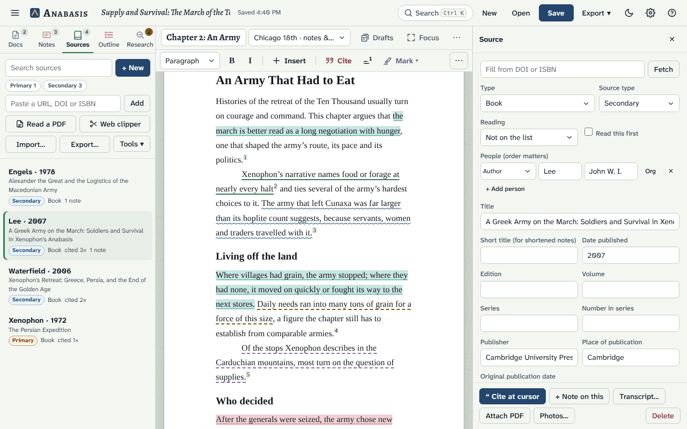
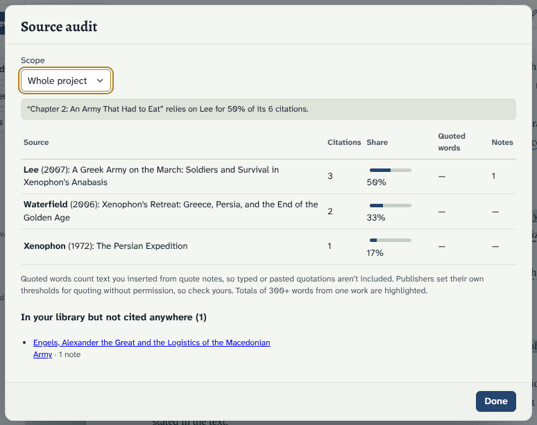

The **Sources** tab is the project's bibliography. Every source you add is available to cite in any document, and its details are kept in CSL-JSON, the format Zotero, Mendeley and most citation tools understand. This page covers getting sources in, describing them well, and the tools that check them.

## Adding a source

### The quick way: paste an identifier

Paste a **DOI**, an **ISBN** or a **web address** into **Paste a URL, DOI or ISBN** and choose **Add**. Anabasis looks it up and fills in the form:

- A **DOI** is looked up through doi.org, which may hand off to Crossref or DataCite.
- An **ISBN** is looked up through Open Library.
- A **web address** is looked up through Wikipedia's citation service (Citoid) for its author, date and publication. If a site blocks the lookup, or you're offline, the address is saved and you fill in the rest.

Lookups are the only part of adding a source that needs the internet, and only the identifier is sent. Check what comes back; databases sometimes have the wrong capitalization, a missing translator or a reprint's date.

### By hand

Choose **+ New** and fill in the form on the right:

- **Type**: 22 kinds, from book, chapter, journal, magazine and newspaper article through web page, blog or Substack post, report, thesis, interview, speech, film, podcast, dataset and map to archival item, government document, legislation or treaty, personal communication, social media post and AI model output. The fields below change to suit the type.
- **People**: authors, editors, translators and other contributors, each with a role. Use **Organization name** for a corporate author such as a ministry or a newspaper.
- **Title, container, publisher, place and date**, plus whatever the type needs (volume, issue, pages, edition, URL, accessed date, archive and archive location).
- **Fill from DOI or ISBN** at the top of the form looks up an identifier for a source you've already started.
- **Advanced: raw CSL-JSON** gives you every CSL variable, for the rare field the form doesn't show.

### Importing a bibliography

**Import…** reads:

- **Zotero CSL-JSON**: in Zotero, right-click a collection, choose **Export Collection…** and pick *CSL JSON*;
- **BibTeX** (`.bib`) and **RIS** (`.ris`), from EndNote, Mendeley, JabRef, library catalogs and databases;
- lists saved by the **OSINT Citation Generator**.

### From the web: the clipper

**Web clipper** gives you a bookmark button for your browser's bookmarks bar. On any web page, click it to send the page into Anabasis as a source, along with any passage you've selected as a quote note. The clipper needs Anabasis open at a web address, such as the [hosted copy](https://zerohistory.net/anabasis/app/), rather than as a file opened from your disk. Keep Anabasis open in one tab; clips go to that tab.

### From a PDF

In the PDF reader, **New source from this PDF** uses the PDF's DOI when it has one, and otherwise its title, author and date. See [Reading PDFs](Reading-PDFs).

## Describing a source well

### Titles

Type titles the way they should print in the style you use most. Citation styles can't reliably change title case into sentence case, because they can't tell a proper noun from an ordinary word.

### Source type: primary, secondary, tertiary

Set **Source type** on each source:

- **Primary**: made at the time or by those involved, such as documents, records, letters, interviews and data.
- **Secondary**: analysis of primary sources, such as most books and articles.
- **Tertiary**: summaries of secondary sources, such as encyclopedias and textbooks.

A source's notes take the same type unless you give them their own. Filter notes and sources by type with the chips at the top of each list, and turn on **Group by source type** in Page setup to split the bibliography into three sections.

### Reliability and credibility

Under **OSINT Style Guide details**, each source can carry a rating on the Admiralty (NATO) scale: a letter for the source's reliability, from **A** (highly reliable) to **E** (unreliable), with **F** for reliability unknown; and a number for the information's credibility, from **1** (confirmed) through probably true, possibly true, doubtful and improbable to **6** (truth unknown).

Ratings feed the checks. Corroboration warns about paragraphs that rest only on sources rated D–E or 4–5, the claims register warns about claims that do, and the evidence grid shows each source's rating beside every claim that cites it. The Oracle can tell you which sources are rated D or below.

### Annotation

The **Annotation** field holds what the source is, what it argues and how you use it. **Export → Annotated bibliography** turns these into a new document, and the annotated bibliography styles print them under each entry.

### The reading list

Set a source's **Reading** to *To read*, *Reading* or *Read*, and tick **Read this first** for the ones that matter most. The chips at the top of the Sources tab filter the list to what's waiting, with the read-first sources at the top, and **Project home** lists them under *To read*. Mark a source *Read* and it leaves the list.

### A précis

**Précis…** (in the more row at the foot of a source) writes a rhetorical précis in Margaret Woodworth's four sentences:

1. Who said what: the author (and a credential, if you like), the genre and title, the year, an exact verb (*argues*, *contends*, *questions*, *demonstrates*…) and a *that* clause with the claim.
2. How the author develops it (*supports this claim by…*).
3. The purpose, with *in order to*.
4. The audience and the tone.

Fill in the parts and the précis reads as you go, saying what's still to fill in. **Save** keeps it as a summary note on the source, tagged *précis*, so it also feeds the annotated bibliography; **Insert** puts it in the page with a citation, and keeps the note too. **Edit précis** on the note opens it again. **Précis of every source** in the command search makes one document of them all, each under its bibliography entry, for a reading journal or a seminar.

## Working from a source

The buttons at the foot of a source:

- **Cite at cursor** inserts a citation of this source where you were writing.
- **Copy citation** shows the source's citation (a note or an in-text citation) and its bibliography entry, in the open document's style or any other, with a page if you give one. **Copy** puts it on the clipboard with its italics, for an email, a message or someone else's document. To cite in your own draft, use Cite at cursor, so the bibliography keeps track.
- **+ Note on this** starts a note linked to the source.
- **Transcript…** takes a pasted transcript or a caption file (`.srt`, `.vtt`), text or Word file. Select lines to make quote or paraphrase notes with the timestamp as the locator. Caption fragments are joined into sentences with speakers and timestamps, and the search box filters the lines.
- **Attach PDF** or **Read PDF** opens the source's PDF in the reader beside your draft.

## Checking your sources

**Tools** at the top of the Sources tab holds the checks below, and [Archive photos](Archive-Photos).

### Source audit

The source audit shows:

- how many times each source is cited, and its share of all citations;
- a warning when one chapter leans on a single source;
- how many words you quote from each source, which matters for permissions;
- sources missing details a style needs, such as a date or a publisher;
- and sources you haven't cited anywhere.

### Check links

**Check links** asks the Internet Archive's Wayback Machine about each web source: when it last saved a copy, and whether the page was there, had moved or was gone at that visit. A browser isn't allowed to test other websites directly, so this is the archive's record, not a live test. Only your web sources' addresses go to archive.org, one at a time, and only when you choose **Check**.

- **Keep saved copies** stores the archived address with each source. The OSINT Style Guide cites it.
- For a page that's gone, tick the saved copy to cite the archived address in any style.
- **Save now** asks the Wayback Machine to save a page today.
- **Fill in accessed dates** uses the day you added each source.

### Check for retractions

**Check for retractions** asks Crossref about each source with a DOI. Crossref records retractions, withdrawals, expressions of concern and corrections that publishers issue, and since 2023 it includes the Retraction Watch database too.

- Each source shows what Crossref holds: *No notices*, or the kind of notice with its date and a link to read it.
- A retracted, withdrawn or questioned source is marked in the Sources list and listed on **Project home**, so it can't slip into a draft unnoticed.
- Only the DOIs are sent, one at a time, and only when you choose **Check**.

No notice isn't a guarantee: this finds what publishers and Retraction Watch have recorded, for works with a DOI. If a source you rely on is retracted, read the notice. Sometimes the problem is in a part you don't use; either way, it's usually right to say so when you cite it.

### Find duplicates

The same work often comes in twice: once from Zotero and once by DOI, or typed by hand before the PDF turned up. **Find duplicates** lists pairs that look like the same work, because they share a DOI, ISBN or web address, or the same title, author and year.

For each pair, choose **Merge, keep the first** or **keep the second**. The kept record fills its empty details from the other, and every citation, note, archive photo, grid cell and plan link moves across, so nothing points at the record that's gone. **Not the same** tells Anabasis to stop suggesting the pair.

### Permissions log

The **permissions log** lists every figure and table in the project with its credit line and permission status, and highlights what's still to clear: permission needed, requested or refused, or a picture with nothing set. It adds quotations by source, with word counts. Download it as a spreadsheet, or make it a document to send your editor.

## Evidence files and fingerprints

For investigative and open-source work, it can matter later that a screenshot, a video, a leaked document or a downloaded file is exactly what you captured. **Evidence files**, at the foot of a source, records a **SHA-256 fingerprint** of any file: a 64-character code worked out from its exact contents. Change one byte and the fingerprint changes.

- **Fingerprint a file…** works out the fingerprint in the browser. The file isn't stored or uploaded; it stays wherever it is.
- Record **when** and **where** you captured it, and **how** (by whom, with what tool).
- **Check a file against these…** fingerprints a copy and tells you whether it matches any file recorded in the project, byte for byte.
- A PDF linked to a source is fingerprinted automatically, and so is every [archive photo](Archive-Photos).

Keep the files themselves somewhere safe; the fingerprint proves a copy is unchanged, but it can't bring back a lost file.

## Search inside sources

**Sources → Search inside sources** (or *Search inside sources* in the command search) finds words in the full text of what you've gathered, not just in titles and notes:

- the text of every **PDF** linked to a source, page by page;
- the transcriptions of your [archive photos](Archive-Photos);
- interview **transcripts**;
- annotations and abstracts.

Capitals and accents don't matter, so *moltke* finds "Moltke" and *Etat* finds "État". Each hit shows the source, where it is (p. 2; box 3, folder 12, item 4; 00:02:05) and the words around it. Click a hit to open the PDF at that page, the photo, or the transcript.

The first search reads each PDF's text, which can take a moment for a large project; after that it's kept in this browser so searches are instant. The text is never put in your project file. A **scanned PDF** has pictures of pages and no text, so it's listed as scanned: open it in the reader and choose **Read text** to read its pages on this computer (see [Reading PDFs](Reading-PDFs#scanned-pdfs-read-text)), and it can be searched from then on.

## My library: sources for every project

A project file holds the sources for that project. **Sources → My library** is a shelf that every project can use, kept in this browser.

- **Save to library**, at the foot of a source, puts it on the shelf with its notes. **Save this project's sources** in My library shelves every source in the project.
- In another project, open **My library**, search it, tick the sources you want and choose **Add to this project** (or **Add** on a single one). Leave *Add their notes too* ticked to bring their notes as well. Sources already in the project are marked, so you don't add one twice.
- The shelf doesn't keep the same source twice. It matches by DOI, then ISBN, then title, year and first author, and saving a source again updates it and adds any new notes.
- **Export** saves the whole shelf as a file, to keep or to take to another computer or browser; **Import** adds one in. The library is never sent anywhere, and it isn't in any project file unless you add sources to a project.

## Taking sources elsewhere

**Export…** in the Sources tab saves your sources as **BibTeX**, **RIS** or **CSL-JSON**, for Zotero, EndNote, Mendeley or JabRef: either all of them, or only those cited in the open document. Each source gets a readable key such as `tuchman1962guns`, the same key the Pandoc and LaTeX exports use.

## Tips

- **Add the source before the quotation.** A note linked to a source carries its citation into the draft.
- **Fill in the details once, carefully.** Every citation of the source, in every style, comes from this form.
- **Run the source audit before you send a chapter out.** It's the quickest way to find a missing date or a source you meant to use.

## Related pages

- [Citations and styles](Citations-and-Styles)
- [Reading PDFs](Reading-PDFs)
- [Checking the draft](Checking-the-Draft)
