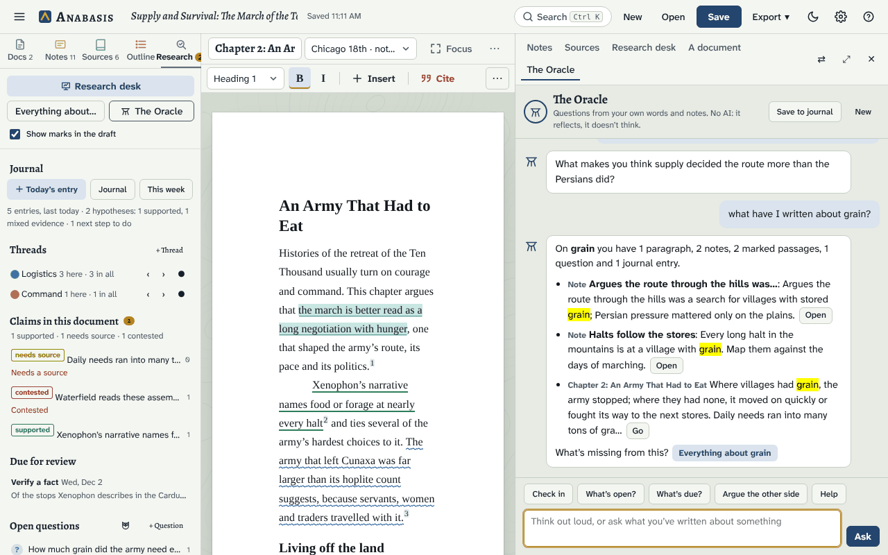

The Oracle is a conversation partner for working alone. Tell it what you're writing, what's bothering you, or what you think the evidence shows, and it turns your words back into questions, points you to things in your own project, and files notes and journal entries when you ask. It's what talking a problem through with a patient colleague is for: hearing yourself say it.

The Oracle is built in the manner of **ELIZA**, the program Joseph Weizenbaum wrote at MIT in the 1960s. It has no AI and nothing goes online. It works from a script of keywords and sentence patterns, remembers a few things you've said, and answers from your own notes, sources and drafts. It reflects; it doesn't think. That's the point: the ideas in the conversation are all yours.

## Opening the Oracle

- **The Oracle** in the Research tab opens it beside the writing, ready to type.
- **The Oracle** tab in the panel beside the writing (**Ctrl+\\**).
- **Mark → Consult the Oracle…** (or **O** after **Ctrl+Alt+G**) with a passage selected, to have it read the passage back to you with questions.

Type and press **Enter**. The buttons above the box (**Check in**, **What's open?**, **What's due?**, **Argue the other side** and **Help**) say the common things for you. **New** starts a fresh conversation. **Save to journal** keeps the conversation (see below).

## Talking it through

Say what's on your mind, in ordinary sentences. "I think the retreat was decided by supply, not by the Persians." "Chapter 3 is a mess." "I'm not sure Lee is right about the numbers." The Oracle answers with a question that turns your sentence around: what makes you think so, what would change your mind, what a reader would ask.

### What it notices

- **Its own last question.** It keeps track of what it just asked, so a plain "yes", "no" or "hmm" gets a sensible reply rather than a non sequitur.
- **What you've said before.** It remembers a few things you mentioned earlier in the conversation and brings them back when they bear on what you're saying now.
- **Your sources' authors**, by name. Mention Lee or Waterfield and it knows they're authors in your project.
- **Certainty.** Say "obviously", "clearly" or "it proves" a few times and it notices.
- **Repeating yourself**, being stuck, tired or unsure. After a few "not sure"s, it suggests something concrete to do.
- **Thanks, praise and frustration.** It answers those as a person would, briefly, and gets back to the work.
- **Questions about itself.** Ask what it thinks, or whether it's a bot, and it tells you plainly what it is.

### Reading you properly

It copes with word endings (*supplies*, *supplied*, *supplying*), with a typo or two, and with "not": "I don't think the army starved" isn't treated as a claim that it did. Given a long message, it answers at its most telling sentence rather than the first one.

### Pointing into your project

When what you say is close to something you've already written, the Oracle says so, with a link: a note on the same subject, a source that discusses it, or a paragraph that makes the same point without a citation yet. It searches the project in the browser each time; the search index is built on the spot and thrown away.

If you saved your last conversation to the journal, it can pick up where you left off.

## Asking about the project

The Oracle answers plain questions about where things stand:

| Ask | It tells you |
|---|---|
| what have I written about *grain*? | the paragraphs, notes and sources that mention it |
| how many claims need a source? | the claims in the register with no citation |
| which claims are contested? | claims marked contested |
| which sources are rated D or E? | sources rated D, E or F for reliability, among those you've rated |
| what's open? | open research questions |
| what's due? | review keys coming due or overdue |
| any TKs? | TK, cite? and check flags in the drafts |
| what's next? | open next steps from the journal |
| how many notes (sources, claims, threads…)? | the count |
| how far am I from my word goal? | words so far, the target, and the pace you need |

## Asking it to file things

Start a message with a kind and a colon, and the Oracle files it:

- `note: The army bought grain at Trapezus for the first time in months.` makes a note.
- `question: How many men reached the coast?` makes an open research question.
- `hypothesis: Supply, not the Persians, set the route.` adds a hypothesis to the journal.
- `log: …`, `idea: …`, `found: …`, `decided: …`, `dead end: …` and `next step: …` add journal entries of that kind.

Longer forms work too: "save that as a question", "make that a note", "note that the dates disagree". Each comes with **Undo**.

## Arguing the other side

Say **argue the other side** (or "play devil's advocate", "push back", "poke holes") and the Oracle takes the opposing view of your claim and keeps pushing until you say **stop**. It's a way to rehearse the objections before a reader raises them.

To test a claim more formally, say **examine:** followed by the claim. That hands it to [Socrates](Socrates), who walks you through defining it, testing it against a passage from your own notes, and mending it.

## Consulting the Oracle about a passage

Select a passage in the draft and choose **Mark → Consult the Oracle…**. It reads the passage back with questions about its sources, its numbers, its hedges and its causes: which sentence carries the citation, where a figure came from, whether "probably" is doing honest work, what else might explain what you describe.

## Starting and ending the day

- **Check in**: say "check in" or "good morning" and it starts the day with what's waiting: review keys due, open next steps from the journal, open questions, TKs and flags left in the drafts, and how far you are from your target, with the words a day you need to finish on time. The first visit each day does this for you.
- **Done for today**: say "done for today" or "that's it for now" and it asks what you did, logs your answer in the journal, and signs off with one of the maxims of Delphi, in Greek and English.

## Keeping a conversation

Conversations are forgotten when you close Anabasis or press **New**, unless you press **Save to journal**. That adds the whole exchange to today's journal log, tagged *oracle*. Only then is it kept, and only in your project file. In a long conversation the Oracle offers to save before useful things scroll away.

## What the Oracle isn't

The Oracle doesn't know anything about your subject, and it can't check a fact or tell you whether an argument is good. Its questions come from your own words and your own project. If it says something odd, that's the script showing through. Rephrase and carry on, or start a new conversation.

If you want a second reader who actually understands the argument, use **Send a copy for review** to send the project to a person. See the Export menu.

## Tips

- **Say what you'd say out loud.** Full sentences get better questions than keywords.
- **Use it when you're stuck, not when you're flowing.** It's for getting moving again.
- **File as you go.** `note:` and `question:` turn half-thoughts into things you can find later.
- **Save the good conversations.** A saved conversation in the journal is a record of how an idea took shape.

## Related pages

- [Socrates](Socrates)
- [The research journal](Research-Journal)
