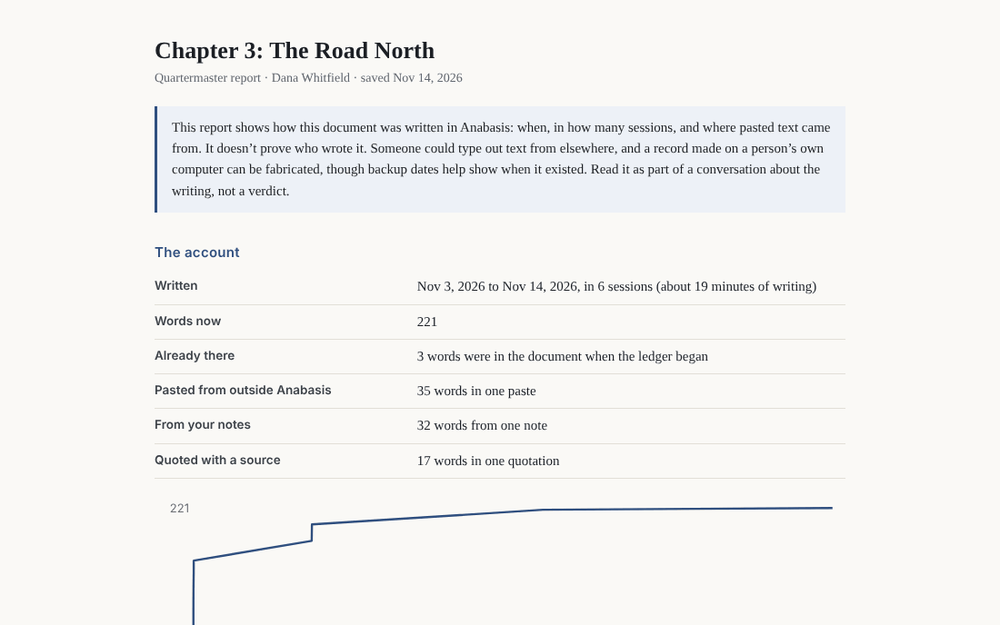
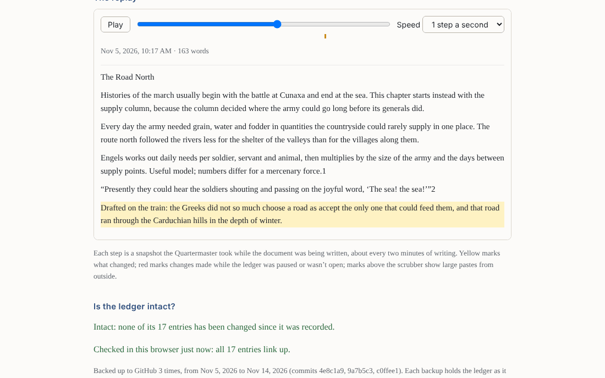

The Quartermaster keeps an honest account of how a document is written. A quartermaster keeps the army's books; this one keeps a ledger of your writing: when you worked on it, how it grew, and where pasted text came from. Save it as a report to show your process to a teacher, an editor or a reader.

It shows a process. It can't prove who wrote something, and every report says so.

## Turning it on

The Quartermaster is off until you turn it on, one document at a time. Choose the **Quartermaster** button in the document bar (or find it in the bar's **⋯** menu), then **Keep a ledger for this document**.

While it's on, a small **Ledger** badge sits beside the word count. Click it to pause the ledger, resume it, save a report or delete the ledger.

## What it keeps, and what it never keeps

**It keeps:**

- a snapshot of the document's text every couple of minutes while you write, stored as the difference from the snapshot before;
- for each paste or inserted note, whether the text came from **outside Anabasis**, **your notes**, **a quotation with its source**, or **elsewhere in this project** (text you moved);
- when you paused and resumed;
- when the project was backed up to GitHub, if you use GitHub backup.

**It never keeps** keystrokes or your typing rhythm, anything outside Anabasis, your clipboard beyond what you paste into the document, your other documents, your location, or anything about your device.

The ledger lives inside the document in your project file. Nothing leaves your computer unless you save a report or back up to GitHub. A locked project's ledger is locked with it. A copy you send to a collaborator leaves the ledger out.

## The report

In the Quartermaster window, choose **Save report…**. You get one web page that opens in any browser, needs no account, and contacts nothing. It holds:

- **the account**: the dates you wrote, how many sessions, about how long, the words now, what was already there when the ledger began, and how many words were pasted from where;
- **a chart** of the words in the document over time;
- **the text, marked by where it came from**: written here, pasted from outside, from your notes, or quoted with a source;
- **the replay**: every snapshot in order, with play, pause, speed and a scrubber, the changes in each step shaded;
- **whether the ledger is intact**, checked by Anabasis when you saved it and again in the reader's browser when they open it.

Before saving, you choose whether the replay goes in (it shows everything the document said along the way, including passages you later cut), whether your name goes in, and whether the titles of notes you used go in.

## Is it intact?

Every entry in the ledger carries a fingerprint (SHA-256) of the entry before it. Change, remove or reorder an entry afterwards and the chain breaks there, and the report says where. A ledger copied into another document or project shows that too.

There's an honest limit. The chain shows the ledger hasn't been edited; it can't show the ledger is genuine, because there's no secret in it and a whole ledger could be made up from scratch. **GitHub backups** help: each backup commit holds the ledger as it was then and names its latest link, so the backups show when it existed.

## Reading a report fairly

For teachers, editors and anyone a report is sent to:

- **The report describes; it doesn't judge.** There's no score and no "likely AI". Read it as a starting point for a conversation about the writing.
- **Ordinary writing looks messy.** Pauses, long gaps, late nights, rewrites, a paragraph moved, an outline pasted from the writer's own notes: none of that means anything.
- **Pasted from outside isn't misconduct.** Writers paste their own drafts from other apps, notes from a phone, or a quotation they then cite. Text drafted elsewhere and pasted in shows as one large paste. Ask about it.
- **Dictation and assistive tools** put text in without typing. Dictation shows as writing in Anabasis; some word-prediction tools and phone keyboards can look like pastes.
- **Pasted then rewritten shows as written here.** A sentence is marked as pasted only while its words still match what was pasted.
- **"Changed while not kept"** means the document changed while the ledger was paused, or in another browser or an older version of Anabasis. It's worth asking about, not a verdict.
- **It can't prove authorship.** Someone could type out text from elsewhere, and anyone can fabricate a record on their own computer. Backup dates make that harder, not impossible.

## Pausing and deleting

**Pause** stops the ledger; anything you change while it's paused is shown as such when you resume. **Delete ledger…** removes it from the document (the document itself isn't touched). Copies already in your saved files, checkpoints and GitHub backups stay as they were.

## Limits

- A ledger stops when it reaches about 40 MB; save a report, then delete it to start a new one. A typical essay's ledger is a few hundred kilobytes.
- The Quartermaster works in the main window, not in a document popped out to a second window.
- See [SECURITY.md](https://github.com/gmichaelrapp/anabasis/blob/main/SECURITY.md) for how a ledger in a file from someone else is checked before anything in it is used.

## Related pages

- [Projects, saving and privacy](Projects-and-Saving)
- [Exporting](Exporting)
- [Checking the draft](Checking-the-Draft)
