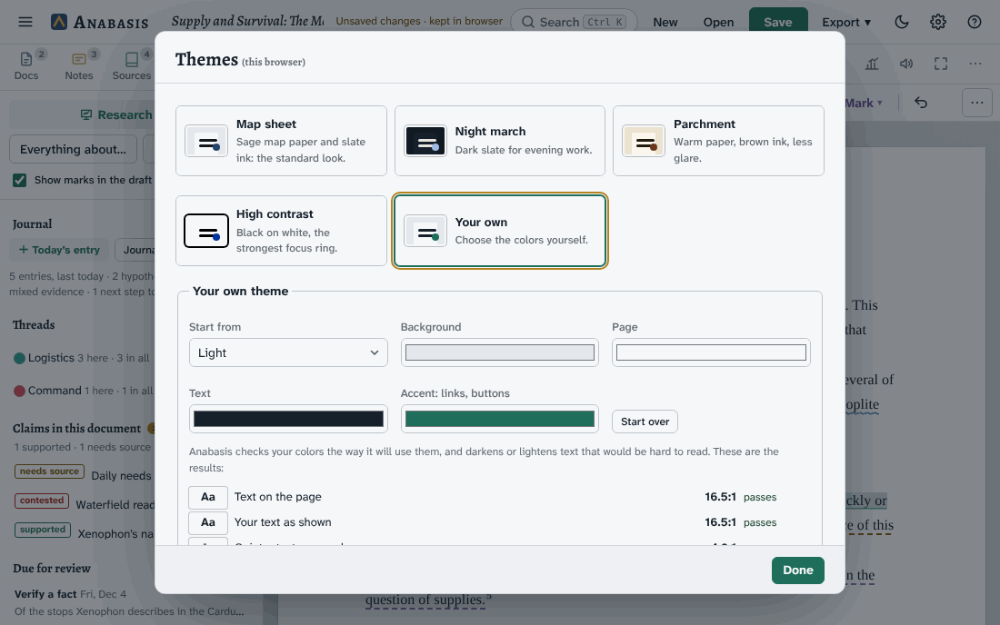
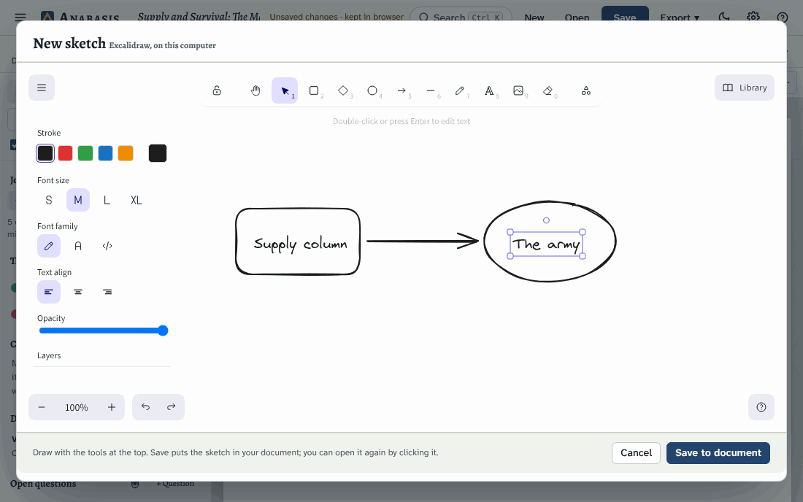

Anabasis 2.12 gives you more say over the desk you work at: how it looks, what fills the screen, what's on your list for each part of the work, and what you can put on the page besides prose.

## Themes

Open **Settings → Themes…** (or press ⌘/Ctrl+K and type “themes”). There are five:

- **Map sheet**: sage map paper and slate ink, the standard look.
- **Night march**: dark slate for evening work.
- **Parchment**: warm paper and brown ink, with less glare.
- **High contrast**: black on white, with the strongest focus ring.
- **Your own**: choose the background, the page, the text and the accent (links and buttons), starting from light or dark.

Anabasis checks your own colors the way it will use them: text on the page, quieter text on panels, links, button labels. If a color would be hard to read, Anabasis shows it darkened or lightened until it reads clearly, and says so. **Use the adjusted colors** keeps the adjusted versions.

Every built-in theme passes the WCAG AA contrast checks for text, buttons and marks; the test suite checks each one, including highlights the browser paints (find results, names) and the drafting colors below.

The moon button in the top bar still switches between dark and light: to Night march, and back to the light theme you used last. Themes are kept in this browser, not in the project file.

## Workspaces

The **Workspace** button in the document bar (two panes) gives one part of Anabasis the screen, with another beside it, smaller:

- **Large**: the writing, notes, sources, the research desk, the Oracle, or another document.
- **Beside it, smaller**: any of those, or nothing.
- How wide the smaller part is, which side it goes on, and whether to go full screen.

Some layouts that work well: notes large with sources beside them, while sorting what you've read; sources large with the writing small, while checking citations; the research desk with the Oracle, while thinking a claim through.

**Swap** trades the large and the small parts. **Exit** (or Esc) puts every pane back where it lives.

## Tasks for any part of the work

Press **Tasks** (the checklist button in the document bar). A list opens for the whole document, a chapter or an article. If your cursor is in a section, a button offers **+ List for “…”** that section, under its heading.

- Each task can have a due date. Tasks due today or overdue show on **Project home** (the Tasks card) and in **⌘K → Tasks due**, and you're reminded once a day when you open the document.
- A heading with a list shows a small count at its right edge. Click it to open that section's list.
- A section's list follows its heading: move the section to another document, and the list moves too. Delete the heading, and its tasks join the document's own list rather than vanish.
- **Clear finished** tidies a list.

## Drafting colors

Select a passage and press **Drafting color** in the toolbar (the A with a bar). Choose blue, green, amber, red, purple or gray, and write beside each what it means to you: *rewrite*, *check*, *keep*, *cut*. The number beside each color counts its passages across the project; click it to jump to the next one.

Each color has its own underline style (solid, dashed, dotted, wavy, double), so color is never the only cue. Colors are a drafting aid: exports leave them out unless you tick **Keep colors in exports**.

## Code snippets

**Insert → Code snippet** keeps code exactly as you type it, for documentation: a fixed-width face, no formatting, and never run. Give it a language label if you like. Click a snippet to edit, copy or delete it.

In exports, Markdown gets a fenced block (with enough backticks that the code can't close it early), web pages and PDFs a `<pre><code>` block, and Word a fixed-width font on a light gray band.

## Sketches with Excalidraw

**Insert → Sketch** opens [Excalidraw](https://excalidraw.com), the hand-drawn whiteboard, for a diagram, a map of how things connect, or a quick figure. **Save to document** puts it in the document as a figure with a caption, and keeps the drawing in the project. Click the figure, then **Edit sketch**, to draw more.

The figure is a picture, so Word, PDF, the web page and every other export carry it. Excalidraw runs entirely on your computer, in a sealed frame:

- it comes with Anabasis (fonts included) and never goes online;
- the frame has no access to your project, the page or this browser's storage, only to the drawing it's given;
- links and embedded web pages are taken out of a drawing before it opens.

## Notecards you wrote by hand

**Notes → Cards…** brings in index cards written outside Anabasis.

- **Photos of cards**: photograph each card and choose the photos. The text is read on this computer by the same offline text recognition the reader uses; nothing is uploaded.
- **Typed cards**: type or paste them with a line of three dashes (`---`) between cards.

A card can say where it came from. `Source: Tuchman 1962` (or `(Tuchman 1962, 41)` at the end) finds the source among yours by author and year; `p. 23` is the page; `#supply` lines are tags. A card wrapped in quotation marks becomes a quotation. The first short line is the title.

Every card is shown before it becomes a note, so you can fix what the recognition misread, pick the source, or leave a card out. The notes are tagged *notecard*.

## Arranging Project home

On **Project home**, press **Arrange this page**. Each card gets controls: move it earlier or later (or drag it), make it wide or narrow, hide it. Four cards can be added: **Tasks**, **Pinned notes**, **A question from Socrates** and **Quick note**. **Back to the standard layout** undoes it all. The layout is kept in this browser.

## Related pages

- [Getting started](Getting-Started)
- [Notes and the board](Notes-and-the-Board)
- [Exporting](Exporting)
- [Socrates](Socrates)
- [The Oracle](The-Oracle)
